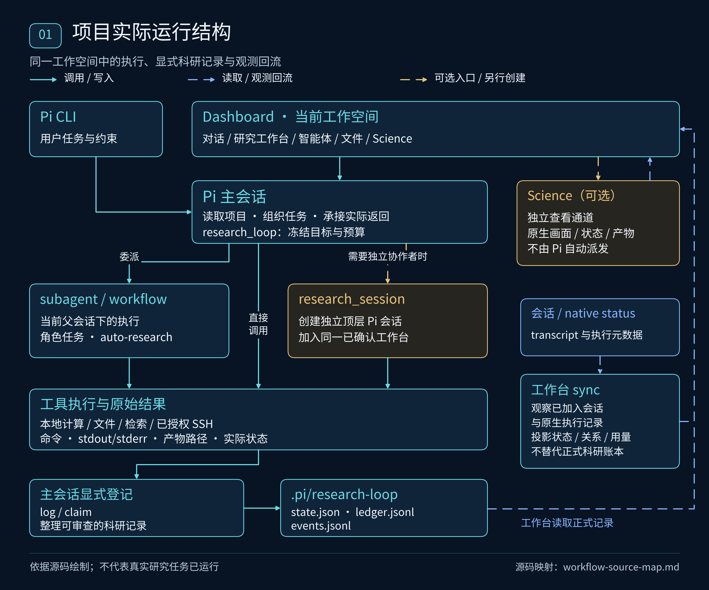
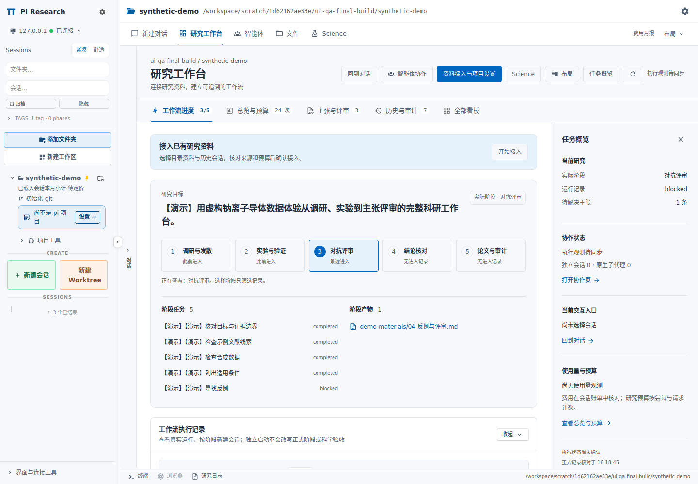
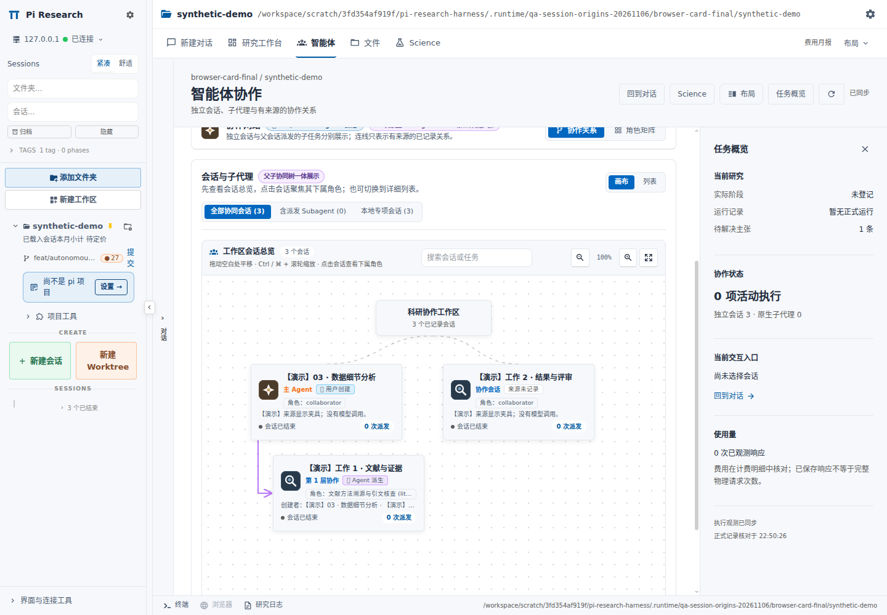
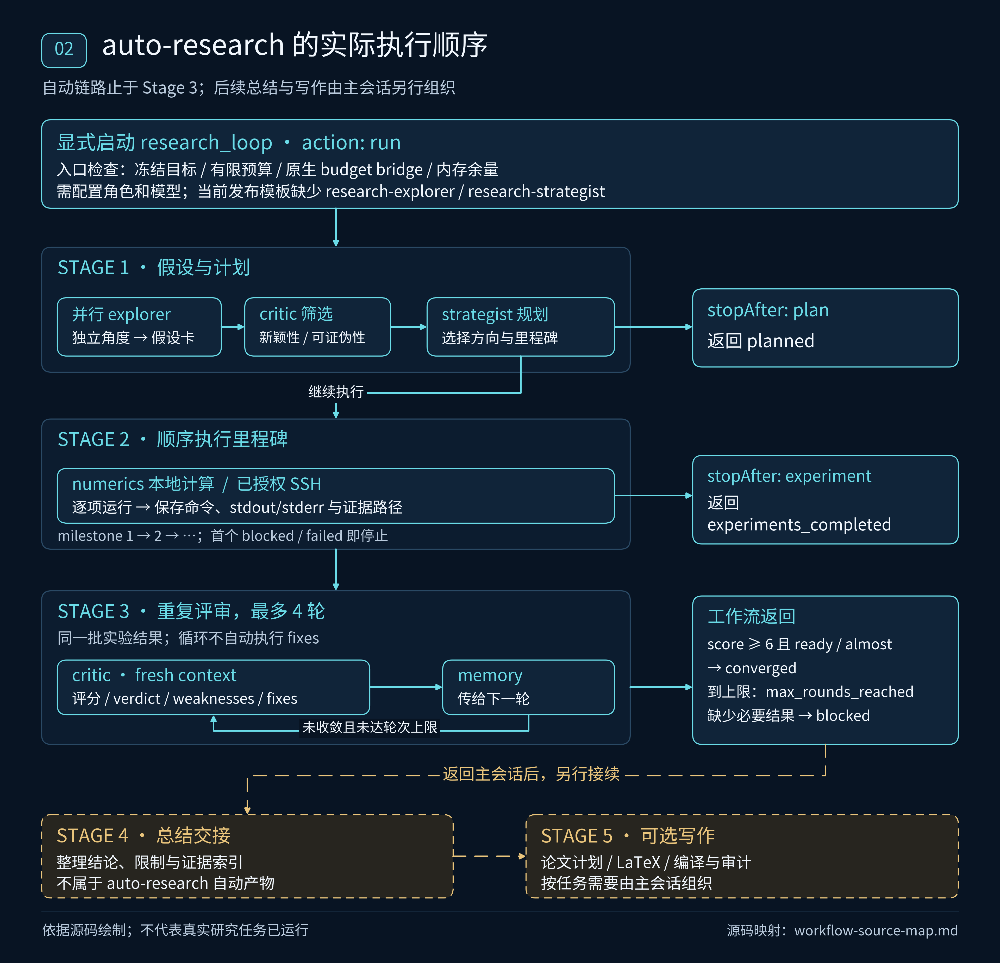
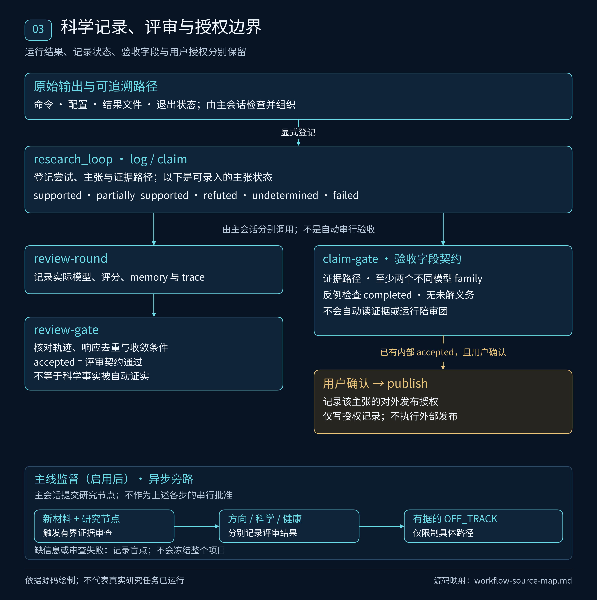

# Pi Research Harness

**围绕同一个研究目标，组织 Pi 会话、科研子代理、计算验证与证据记录。**

Pi Research Harness 把 Pi 的执行能力、研究角色与技能、项目级研究记录，以及定制 Dashboard 组合成一个可保存、可检查、可继续开发的科研工作环境。你可以从一个研究问题开始，也可以把已有目录和选定历史会话接入工作台，在同一处查看任务、原始产物、尝试记录、主张和评审。

Pi 负责实际会话与工具执行；本仓库负责科研集成、配置、记录契约和工作台定制。研究结果需要回到原始证据核查，模型任务结束、评审停止和科学主张被接受分别记录。

[](https://github.com/northkd/pi-research-harness/actions/workflows/ci.yml)


> **当前为 0.20.0 开发源码。** 本分支恢复主 Agent 指定和五阶段独立启动，使用“默认权限 / 完全访问”替代长任务授权，移除常规研究启动的预算前置。试用请检出 `feat/autonomous-collaboration-20261106`；[当前控制与验证说明](docs/workflow-controls/implementation.md)记录实际范围。递归分发执行器、协作层级画布和计费性能面板继续保留。完整自动研究、Science 和部分后端集成仍需本机配置，见[可用范围](#可用范围与已知问题)。

当前修复区分主 Agent 选择、工作流接入与目标版本绑定。
旧确认回执通过平台追加版本衔接，保留原 workflow 和研究记录。
原生子代理保持指定的具体模型，发送前核验自动路由接管。
操作入口、错误码、模型兼容边界见[目标绑定与子代理模型说明](docs/charter-binding-models/README.md)。

工作区会话总览默认 `100%`，返回总览恢复 `100%`。
画布与列表区分“用户创建”“Agent 派生”“来源未记录”。
派生会话显示实际创建者与父子连线，旧版有效父记录沿保存与归档保留。
规则与实测范围见[会话来源与默认缩放说明](docs/session-origins/README.md)。



*以上是按当前源码绘制的运行结构图。全部流程图提供 [SVG 与绘图脚本](docs/images/README.md)，节点、箭头及适用条件见[源码对应表](docs/images/workflow-source-map.md)。图中的外部能力需要本机配置；图本身不表示真实研究任务已经运行。*

## 导航

- [工作台能做什么](#工作台能做什么)
- [一次研究实际怎样推进](#一次研究实际怎样推进)
- [会话、子代理与科研角色](#会话子代理与科研角色)
- [访问权限与分发执行器](#访问权限与分发执行器)
- [证据、评审与发表授权](#证据评审与发表授权)
- [持续推进、监督与阶段识别](#持续推进监督与阶段识别)
- [可选服务与集成](#可选服务与集成)
- [从源码开始](#从源码开始)
- [数据保存在哪里](#数据保存在哪里)
- [开发与验证](#开发与验证)
- [可用范围与已知问题](#可用范围与已知问题)
- [文档与许可证](#文档与许可证)

## 工作台能做什么

### 五个主视图，共享项目与会话上下文

| 入口 | 主要用途 | 保留的操作 |
|---|---|---|
| **对话** | 与当前 Pi 会话交互，查看思考、工具调用与结果 | 模型与思考级别、发送、队列、steering、停止、后台任务、历史定位、最后消息撤销并编辑 |
| **研究工作台** | 围绕目标查看阶段、任务、产物、用量与证据 | 主 Agent 选择、五阶段独立启动、研究总览、访问权限、主张与评审、历史与审计；资料接入和项目设置 |
| **智能体** | 查看协作会话的真实创建层级、原生子代理与工作流步骤 | 父子连线、创建者导航、画布内展开多轮执行、列表、角色矩阵、搜索、缩放、聚焦、执行详情与文字纠偏 |
| **文件** | 在项目目录中阅读、编辑和比较文件 | 文件树、标签、Markdown 等编辑预览、差异、搜索、专用 viewer 与插件文件处理器 |
| **Science** | 访问另行配置的 Science 查看服务 | 原生工作区/任务画面、产物预览、原始下载与哈希核对；实例列表从工作台总览进入 |

左侧保留目录与工作区、会话搜索和分组、恢复、Fork、重命名、归档、关闭、工作树与原有会话菜单。项目工具仍承接 Git、OpenSpec、Goal、Automations、Flows、KB 等入口；具体可用性取决于对应插件和环境。

布局菜单集中提供分屏、全宽和比例；底部保留多终端、已有浏览器标签恢复和研究日志。切换主视图保留未发送消息与已打开文件的编辑状态；显式关闭标签、终端和切换项目仍按各自生命周期处理。浅色、深色、自定义主题、语言和显示偏好继续保留。

### 实际构建界面





*截图来自实际构建的 Dashboard、原生服务和认证流程，画面内容为明确标注的合成演示数据。工作台截图保留 2026-11-05 验证，协作画布更新为本分支 2026-11-06 验证；它们不表示正在执行真实科研任务。*

[画布内直接展开](docs/autonomous-collaboration/screenshots/12-subagents-spread-1440.png) · [当前访问权限与工作流入口](docs/workflow-controls/implementation.md) · [窄屏展开](docs/autonomous-collaboration/screenshots/13-subagents-spread-360.png)

[对话](docs/ui-redesign/screenshots/10-session-chat-1440.png) · [文件](docs/ui-redesign/screenshots/03-files-1440.png) · [费用详情](docs/ui-redesign/screenshots/11-usage-drawer-1440.png) · [Science 未连接时的入口](docs/ui-redesign/screenshots/04-science-1440.png) · [深色主题](docs/ui-redesign/screenshots/09-workbench-dark-1440.png) · [手机宽度](docs/ui-redesign/screenshots/08-workbench-light-360.png)

全部原功能的入口与验证范围见 [F01–F56 功能保全审计](docs/ui-redesign/feature-preservation.md)。

### 用量、费用与消息编辑

费用入口可从不同主视图打开，提供性能/TPS、主会话与子代理分账、模型、缓存、按次费用及历史月报；月报按上海时区的日历月统计。费用依据现有记录和配置价格计算，未定价部分会明确显示，不能把未知价格理解为零，也不能把工作台统计当作供应商账单。

“速度与性能”使用 Pi 端采集与本项目计算，参考 CC Switch 的实际请求统计方式。面板区分首输出等待、首输出后的观测生成速度，以及包含等待的 `≈` 全程估算；缺失计时显示未记录。均速限定同一 provider、model 和主/子 agent 类型，观测与估算分别统计最近 30 个有效样本。失败请求保留已发生的费用，排除正常性能均值。新采集需要加载更新后的 Bridge 扩展，旧日志继续使用明确标注的估算。计算公式、来源与限制见[模型测速说明](docs/model-speed/implementation.md)。

“撤销并编辑”只作用于当前活动分支的最后一条用户消息：先让模型和工具停止，再把原文取回输入框，修改后重新发送。无法安全导航的历史结构会被拒绝。这个操作不会撤销已执行的命令、文件修改或外部操作，原始持久历史仍保留。CLI 对应入口为 `/undo-last`，实现见 [undo-last.ts](extensions/undo-last.ts)。

## 一次研究实际怎样推进

### 1. 明确项目目标，或接入已有研究

新问题由本目录的 Pi 会话配置研究目标、成功标准、非目标与约束，保存为项目的研究约定（`charter`）。
研究执行无需填写尝试次数、模型请求次数或费用上限；预算由使用者把控。常规研究、资料接入、旧预算适配器与 Goal 均保留实际用量记录，不按旧额度自动停机。已有安装需更新相应运行组件，见[无研究预算上限的执行策略](docs/research-budget-policy.md)。
修改已冻结的目标继续使用现有确认流程，保留原验收标准及变更记录。

已有研究可以从工作台的“资料接入与项目设置”进入：选择目录资料和历史会话，核对材料范围与分析模型，授权分析后检查接入草案，再确认目标和成功标准。计划批次用于说明工作量，不是请求额度。历史选择有覆盖核查和恢复记录；确认接入保存来源关联，并在需要时建立研究约定。

**确认接入不会自动启动研究。** 服务端确认路径使用 `autoRun: false`；它也不会恢复旧任务、登记一次实验或接受科学主张。实现见 [接入服务](patches/dashboard-v0.20/overlay/packages/server/src/res-workflow/adoption-service.ts)。

### 2. 选择这次要推进的工作

工作台提供几种不同入口：

| 操作 | 实际发生什么 |
|---|---|
| 指定主 Agent | 选择本项目的 Pi 会话；“打开主对话”和“发送任务”使用该会话 |
| 浏览某个阶段 | 只筛选该阶段记录；“正在查看”和正式研究阶段分别显示 |
| 接续已有研究 / 新启动工作流 | 生成可复制指令；在当前项目 Pi 对话里检查并发送后才执行 |
| 独立启动一个阶段 | 先编辑首条 Prompt，确认后创建加入同一工作台的独立 Pi 会话 |
| `research_loop` 的 `run` | 在前置条件满足时，从 Stage 1 启动自动流程；不能用它冒充恢复历史进度 |

接续时先查看现有状态、运行回执、已保存产物和当前权限，再决定下一项任务。
会话启动后可以恢复尚未结束运行的**进度观察**；这不保证进程终止或服务器重启后，原模型与计算任务仍然存在。

对应实现：[工作台启动指引](patches/dashboard-v0.20/overlay/packages/client/src/components/research/ResearchStartGuide.tsx)、[阶段会话入口](patches/dashboard-v0.20/overlay/packages/client/src/components/research/ResearchExecutionPanels.tsx)、[研究循环工具](extensions/research-loop/src/index.ts)。

### 3. 五阶段组织与当前自动流程

| 阶段 | 研究工作 | 阶段约定的主要产物 | 当前执行方式 |
|---|---|---|---|
| **1 想法发现 / 调研与发散** | 文献线索、多角度假设、新颖性与可证伪性筛选、选择方向 | `idea-stage/IDEA_REPORT.md` | 主会话委派，或自动流程的探索、批评与规划 |
| **2 实验桥接 / 实验与验证** | 最小验证计划、本地数值或已授权远程实验、保存原始输出 | `refine-logs/EXPERIMENT_PLAN.md`、`runs/` | 主会话委派，或自动流程按里程碑顺序执行 |
| **3 自动评审 / 对抗评审** | 检查证据、边界、反例、缺口与可复现性 | `review-stage/AUTO_REVIEW.md`，及另行登记的评审记录 | 自动流程可多轮调用 critic；正式评审记录与 gate 需另行执行 |
| **4 总结交接 / 结论核对** | 将主张逐项对回产物，保留失败与未定项，交接后续工作 | `NARRATIVE_REPORT.md` | 由主会话、独立阶段会话与相应技能接续 |
| **5 论文写作 / 论文与审计（可选）** | 论文计划、写作、引用核查、编译和审计 | `PAPER_PLAN.md`、`paper/*.tex`、`paper/main.pdf` | 另行启动写作工作；编译环境需要单独配置 |

这些路径是[阶段与技能映射](extensions/research-loop/stage-role-skill.json)中的产物约定，不保证每次运行都会自动生成全部文件。当前 `auto-research.js` 串接的是 **Stage 1 → Stage 2 → Stage 3**。



当前自动脚本的行为可以直接核对：

1. `research_loop({action: "run"})` 或 `configure(autoRun: true)` 检查内存准入和当前会话，直接请求原生 subagents 运行 workflow；常规路径不注入预算桥。
2. Explorer 以独立上下文从不同角度提出假设卡；critic 筛选，strategist 选择方向并制定实验里程碑。
3. 实验按里程碑**顺序**执行，由 `research-numerics` 或 `research-ssh` 承担。任一项未返回 `completed`，自动流程就返回 `blocked`。
4. Critic 最多评审四轮，下一轮带上上一轮的评审 memory。达到代码中的停止条件，返回 `converged`；达到轮数上限，返回 `max_rounds_reached`。

`stopAfter: "plan"` 和 `stopAfter: "experiment"` 可以分别在计划或实验后返回。当前评审循环会传递批评意见，**没有自动执行 fixes、修改代码并重跑实验的调用段**；补实验与改方法需要主会话组织后续动作。`converged` 只是这一脚本的停止结果，不直接授予主张验收或发表权限。

**自动流程的启用条件尚未在全新安装中补齐。** 仓库的 10 个角色模板不含自动流程引用的 `research-explorer`、`research-strategist`；阶段映射还引用了未附带模板的 `research-reframer`。模型策略也包含具体 provider/model ID，需要和自己的可用模型目录对齐。使用前需补齐对应角色、模型和原生 subagents 服务；不能把“有工作流源码”理解为安装后即可完整跑通。

依据：[自动流程实现](extensions/research-loop/workflows/auto-research.js)、[启动与恢复](extensions/research-loop/src/index.ts)、[原生启动请求](extensions/research-loop/src/workflow-launch.mjs)、[安装器复制角色的逻辑](scripts/configure.mjs)。

### 4. 把结果保存为可核查的研究记录

运行观察器会记录工作流步骤、状态和回执。主会话或协作会话还需通过 `research_loop` 显式登记尝试、主张、收窄理由和评审；运行事件不会自动变成科学证据。

| 记录 | 保存内容 |
|---|---|
| 尝试 `log` | 假设、目标、动作、预期、实际观察、教训、证据路径及可选重复指纹 |
| 尝试信号 | `positive`、`negative`、`inconclusive`、`blocked`、`error`；失败和未定同样保留 |
| 主张 `claim` | 陈述、支持状态、证据路径和限制条件 |
| 收窄 `narrow` | 为什么取舍、丢弃哪些方向、依据是什么；递增控制环 `phase`，保留旧台账，不自动切换五阶段 |
| 状态与建议 | 根据连续无正信号和重复尝试作确定性诊断，生成有界材料包与策略派发提示 |

`advise` / `dead-ends` 提供供独立策略角色检查的材料包和派发建议，不会直接把模型意见当作证据。原始数据和日志仍放在项目产物目录，台账引用其路径。相关实现见 [ledger.mjs](extensions/research-loop/src/ledger.mjs) 与 [工作流进度观察器](extensions/research-loop/src/workflow-progress.mjs)。

## 会话、子代理与科研角色

### 两种协作方式可以并存

| 方式 | 适用任务 | 实际关系 |
|---|---|---|
| **原生 Subagent / workflow** | 有明确输入和返回结果的理论、检索、验证或批评任务 | 属于某个父会话；父会话组织任务并接收结果 |
| **独立协作 Pi 会话** | 需要独立上下文、持续交互或分阶段推进的工作 | 通过 `research_session` 或阶段入口建立顶层会话并加入同一工作台；前者另存父会话、角色和阶段等派发来源 |

`research_session` 从可信会话上下文核对项目、成员关系与研究约定；子任务不能通过传入任意目录或目标地址跨工作台派发。角色分工也不会自行扩大远程计算、材料外发或发表授权。见 [research_session 实现](extensions/research-loop/src/workbench-session-tool.mjs) 与 [委派策略](extensions/research-loop/src/delegation-policy.mjs)。

智能体画布读取真实派发来源，展示创建者、协作深度和父子连线；分组虚线只表示同一工作区，任务交接也不会被当作父子关系。聚焦会话后可以返回创建者，多轮 Subagent 卡片在当前画布中展开和收起。画布本身不会启动智能体。文字纠偏发往真实目标会话；“已提交”不等于已经执行，也不等于停止其进程。

新建、手动 Fork 与独立阶段入口保存用户创建记录。
`via: spawn` 只表示工作流接入方式，不能判断创建者。
有可靠父记录的会话显示“Agent 派生”；缺少历史证据的会话显示“来源未记录”。
总览默认 `100%`，手动缩放与显式“适应画布”继续保留。

### 已附带的角色模板

| 角色 | 职责 |
|---|---|
| `research-theory` | 数学与物理推导，显式列出假设和待证义务 |
| `research-literature` | 文献检索、来源定位与资料整理 |
| `research-numerics` | 小型本地数值验证和原始结果保存 |
| `research-critic` | 独立批评、反例、证据与论证缺口核查 |
| `research-ssh` | 在已授权主机和范围内核对环境、提交及收集远程计算 |
| `research-web-oracle` | 操作专用浏览器中的网页模型，保留可观察身份与返回证据 |
| `research-agy` / `research-agy-sci` | 通过本机已配置的 agy 外部 CLI 执行对应任务 |
| `research-model-assessor` | 根据任务与记录评估模型适配情况 |
| `research-mainline-supervisor` | 按已冻结目标与授权证据范围进行主线监督 |

完整模板位于 [agents/](agents/)。独立上下文和不同角色有助于交叉检查，但不保证科学正确性；要按实际观察到的模型身份、来源和产物判断独立性。

`research-theory` 默认以 fresh 上下文启动，不继承全局 skills 目录，也不预选技能。需要特定方法时，由派发任务通过原生 `skill` 参数指定；首轮只提供所选技能的名称、说明和路径，正文按需读取。关闭继承的原生 fork 同样过滤父系统提示中的技能目录，保留历史消息。已有安装需更新实际生效的设置与 subagents 补丁，见 [技能按需加载与升级](docs/subagent-skill-loading.md)。

## 访问权限与分发执行器

工作台提供 **访问权限 → 默认权限 / 完全访问**。
选择按操作者和规范项目目录立即保存，直到切回默认。
同一操作者的已注册主会话、工作台协作会话和执行协调者共用该模式。
无需填写任务授权表、附加目录或 12–72 小时期限。
任务目标与交付要求继续发送给主 Agent。

“完全访问”控制应用内执行确认。
操作系统、远程账号和模型服务继续使用运行环境已有权限与凭据。
明确停止、只读任务约束、协作依赖、内存准入和科学证据验收继续生效。
权限覆盖、保存范围与验证边界见[当前控制说明](docs/workflow-controls/implementation.md)。

新的 `research_dispatch` 是持久化分发执行器。对于较大的目标，主 agent 优先通过 `delegate` 一次提交目标、必要约束、验收条件和材料引用，由独立的执行协调者完成详细分析、拆分、跟进、复核与汇总。协调者通过 `plan` 提交有稳定 ID 和依赖关系的任务；执行器创建真实子会话、控制并发、等待结果并通知父会话。协作者收到多个可分开的工作后也要建立计划；单一不可拆分任务使用 `atomic` 说明原因。通过 `research_session.tasks` 明确提交的工作，在子会话注册后由后台自动分发。

子任务须通过 `report` 提交真实状态、摘要和证据路径。idle 不等于完成，未返回的孩子与失败回执不能被上层的成功声明覆盖。语义拆分仍由模型决定；实际调度、依赖和回执由代码执行。等待中的协调者保留驻留资源统计，但不会占满可运行工作者的名额。

主 agent 的默认分发回执限制为 8 KiB UTF-8 文本，重复查询只返回简短的未变更状态；详情按需分页，每页最多 16 KiB，并核对记录版本。子会话不复制父会话全文，工作台记忆块也设有独立字节上限。主 agent 保留目标、关键决策和最终验收，详细材料及执行过程留在协调者与 worker 中。代码限制后续注入量，不会清除已经进入上下文的历史内容，也不承诺降低所有 agent 合计的 token 开销。

当前操作见[主 Agent、阶段启动与访问权限](docs/workflow-controls/implementation.md)。
分发工具、并发限制与上下文测量见[协作执行器历史实施记录](docs/autonomous-collaboration/implementation.md)及[主 agent 上下文减负说明](docs/autonomous-collaboration/context-offload.md)。

## 证据、评审与发表授权



这几种状态回答不同问题：

| 层次 | 含义 | 不由它自动完成的事 |
|---|---|---|
| 运行结果 | 任务是否执行结束、失败、被阻塞或达到脚本停止条件 | 判断科学结论成立 |
| 主张状态 | `supported`、`partially_supported`、`refuted`、`undetermined`、`failed` | 自动获得内部验收或发表授权 |
| `review-round` / `review-gate` | 保存评审轮次、实际模型、响应摘要与前轮关联，检查评审记录契约 | 自动运行所有评审者、保证跨家族独立性、验证全部证据内容 |
| `claim-gate` | 检查主张证据路径、陪审记录、反例完成状态及未解决义务 | 自动执行陪审、反例实验或证明主张正确 |
| `publish` | 在内部接受后，记录用户对该主张版本的明确对外发表授权 | 自动投稿、发送论文或实际发表 |

`claim-gate` 要求至少两位带模型家族字段、横跨至少两个家族的评审者，反例检查已完成，且没有未解决证明义务；提供作者家族时还检查评审家族与作者不同。这是对传入记录的校验，仍需真实审查和证据支撑。只登记一个 `supported` 主张不等于已经通过 `claim-gate`；改变主张的内容或证据也不能沿用旧版本的验收与发表记录。

源码：[评审记录与 gate](extensions/research-loop/src/reviewer.mjs)、[主张 gate 与发表授权](extensions/research-loop/src/ledger.mjs)。

### Feynman、ARIS 与薄适配

`pi_research_fusion` 提供 `route`、`search`、`fetch`、`review-gate`、`derivation-gate` 与 `manifest`：复用已注册的检索工具，保留工具观察和来源，把 Feynman 草稿与 ARIS 阶段产物建立路径对应。`manifest` 生成路径清单，不会把 Markdown 自动编译成论文 PDF。

当前 fusion 的 SSH route 仍是保留且返回 `blocked` 的分支；远程执行使用另行配置的 `research-ssh` 与 SSH 工具。推导 gate 即使满足其诊断条件也只给出 `provisional`，不会把多数一致当作证明。详见 [integration/README.md](integration/README.md) 与[路由实现](integration/src/routes.mjs)。

## 持续推进、监督与阶段识别

| 机制 | 负责什么 | 启用与边界 |
|---|---|---|
| **Goal** | 围绕交付目标继续推进、暂停、恢复和累计轮数 | 需要相应插件及已应用本项目补丁的 native 后端；恢复保留已用轮数，不设置轮数或费用上限。Goal 完成不等于科学验收 |
| **research-loop** | 冻结目标、尝试、主张、证据、阶段和评审记录 | 研究工具随根包注册；真实工作还需要当前会话、模型和任务配置 |
| **主线监督** | 对研究方向与科学支持作后台检查 | 按项目确认模型和最小材料范围；需要新材料与新研究节点，例行代码和测试不逐次触发模型 |
| **空闲阶段识别** | 在整个项目空闲且观测完整时识别进入哪个阶段 | 显式启用的可选服务；保留冷却、变化去重和材料授权，不设置每日请求额度。只写阶段事件，不评价科学质量或启动下一阶段 |

主线监督围绕 `plan_change`、`scope_change`、`stage_complete`、`drift_signal` 等稳定节点工作。方向、科学支持、审查健康分别保存；只有有具体授权材料与路径依据的 `OFF_TRACK` 才可能限制对应分支。信息不足、网络错误或风险提示不会直接冻结整个项目。人工放行也只作用于指定限制，不把旧结论改写成科学认可。

`/mainline-supervision pause` 暂停的是监督机制，不能当作停止全部研究进程。当前也没有实现可永久覆盖未来所有同类限制的流程级裁决。配置与边界见 [主线监督](docs/SUPERVISION.md)、[监督模块](extensions/mainline-supervision/README.md)、[空闲阶段识别](docs/IDLE-STAGE-REVIEW.md)。

研究总览保留尝试次数与实际响应、token 用量，费用在计费明细核对。
常规研究不再读取旧尝试配额，也不因默认 `maxAttempts: 60` 停止。
加载本次新版运行组件后，旧有限或零预算记录保留用于历史核对，不再限制后续执行。资料接入取消总请求与节点恢复额度；Goal 取消默认 20 轮暂停和预算编辑器。更新工作台不会热替换运行中已加载的扩展，升级步骤与边界见[预算策略说明](docs/research-budget-policy.md)。
模型路由模块提供可复用的资格检查和历史记录函数，未作为自动选模或后台跑分守护服务默认启动，见[模型路由说明](integration/model-routing/README.md)。

## 可选服务与集成

### Science 的当前接入位置

Science 从目录工作台进入，不依赖先创建 Pi 会话。Science 主视图承接原生工作区/任务画面及产物查看；**实例列表、实例详情与观测状态位于研究工作台的“研究总览”及“全部看板”**，从那里打开任务或已收集产物。产物提供原始下载和 SHA-256 核对。输入默认关闭，只有 host 允许且满足 frame、scope、lease 等条件时才可由用户开启。关闭视图只退订画面，不取消外部任务。

仓库保留了独立 host 通信、只读组合和产物跟随 worker 的源码；worker 跟随**已有且已授权的任务**，不把输入 Prompt 当作提交新 Science 任务的接口。当前公开启动入口没有自动组装通用项目绑定和完整 Science 运行环境，需要单独部署配置，端到端尚未验收。

依据：[Science UI](patches/dashboard-v0.20/overlay/packages/client/src/components/research/ScienceViewer.tsx)、[服务端接入](patches/dashboard-v0.20/overlay/packages/server/src/res-workflow/science-server-hosts.ts)、[host](patches/dashboard-v0.20/overlay/claude-science/host/science-host-main.ts)、[worker](patches/dashboard-v0.20/overlay/claude-science/worker/science-worker.mjs)。

### 其他可选能力

| 能力 | 仓库提供 | 仍需本人配置 |
|---|---|---|
| 文献与科研技能 | Feynman/web 适配；88 个有来源记录的技能源码快照 | 启用技能发现、检索服务、必要工具与认证 |
| 专用浏览器 | 独立 profile 启动器、Chrome DevTools MCP 配置模板 | Chrome、MCP 依赖、允许的目录与本人登录 |
| 图像生成 | 可选 Pi 绘图扩展 | 本人的兼容图像服务与 `CLIPROXY_BASE_URL` / `CLIPROXY_API_KEY` |
| agy | 外部 CLI 包装与角色 | agy 安装、登录、`AGY_MODEL`，需要时指定 `AGY_BIN` |
| SSH / HPC | 远程角色、工具和调度技能 | 主机、账号、密钥、指定目录、调度环境与具体作业授权 |
| Goal / Automations / Flows | Dashboard 插件入口与可选会话 bridge | 对应插件、native 后端和任务配置；Hermes Goal 后端需另行安装/适配 |
| KB | 插件源码和项目知识库配置模板 | 实际引擎、索引、目录与服务配置 |
| 论文产物 | 写作、编译与审计技能及路径契约 | LaTeX 等环境、真实论文内容、引用与编译检查 |

88 个技能包含 83 个 ARIS 快照和 5 个单独许可技能。使用 `--with-bundled-skills` 才将这些目录加入发现路径；技能文档存在不代表其外部工具已安装。来源与许可记录见 [skill-provenance.json](config/skill-provenance.json)。

## 从源码开始

### 运行要求与固定版本

优先使用 Linux，准备 Bash、Git、Python 3、Node.js 22.19+ 和 npm。Dashboard 上游要求 Node 低于 27；已有 UI 验证使用 Node 24.22.1。构建 Dashboard 还需要 pnpm，准备脚本建议 11.15.1；本次 UI 构建记录使用 11.25.0。macOS、Windows 的差异见[可用范围](#可用范围与已知问题)。

| 组件 | 当前安装基线 |
|---|---|
| Harness | `0.20.0` 开发版 |
| Pi | `1.3.0` |
| pi-subagents | `0.79.2` + 仓库 v0.20 补丁 |
| Dashboard | 上游 `v0.10.0`，固定提交 `65dc4558c7b07ef755ee4f0eda89d9f63e7e76e0` + [校验清单](config/dashboard-v020.json)中的源码覆盖层 |
| 扩展依赖 | 13 个固定版本 npm 包；见 [锁文件清单](config/locks/extensions/package.json) |

基础安装和维护细节见 [0.20 开发与部署](docs/RELEASE-0.20.md)；当前源码检出、认证入口和当前缺口以本 README 的说明为准。下面是创建**全新配置**的顺序；已有配置请合并所需路径，不要重复执行安装器覆盖。

### 1. 克隆并检查源码

```bash
# 本分支包含主 Agent 选择、阶段启动、访问权限与协作执行器。
git clone --branch feat/autonomous-collaboration-20261106 \
  https://github.com/northkd/pi-research-harness.git
cd pi-research-harness

npm test
npm run check:syntax
npm run check:release
```

这些检查不需要模型账号。未准备 Dashboard 运行树时，依赖该运行树的测试会明确跳过；它们不构成真实模型或全部 UI 的验收。

### 2. 一次性选择安装选项，创建隔离 agent

```bash
bash scripts/install.sh --with-dashboard --with-bundled-skills --dry-run
bash scripts/install.sh --with-dashboard --with-bundled-skills

# 已安装 pnpm；目标 .runtime/dashboard-source 必须尚不存在。
# 记录中的前端构建使用了 4 GB V8 堆上限。
NODE_OPTIONS=--max-old-space-size=4096 bash scripts/prepare-dashboard.sh

export PATH="$PWD/bin:$PATH"
```

安装器默认使用 `~/.local/share/pi-research-harness/agent`，拒绝非空目标。需要新配置目录时，在安装前设置 `PI_RESEARCH_AGENT_DIR`。自定义 Dashboard 运行树则在安装**之前**设置绝对路径 `PI_RESEARCH_DASHBOARD_SOURCE`，并在构建与启动时保持一致。

只需要 CLI 时，首次安装省略 `--with-dashboard`，并跳过 Dashboard 构建；需要四个可选 Dashboard 插件 bridge 时，首次安装将该参数换成 `--with-dashboard-plugins`。`--with-browser` 和 `--enable-image-generation` 同样是可选项，仍需配置外部依赖。

安装与准备脚本不会启动、重启 systemd 服务或修改 Caddy。4 GB 是已有构建采用的 V8 堆上限，不是整机内存要求或运行资源保证。

### 3. 配置自己的模型

```bash
pi-research
```

在 Pi 中执行 `/login`、`/model`，选择本人真实可用的模型。完成后退出 Pi，回到 shell 再执行后续命令。兼容接口可以参考隔离 agent 里的 `models.example.json`，在本地配置 endpoint、model ID 与环境变量引用。

使用本机 CLIProxyAPI 时，可以在服务和环境变量已由本人配置好之后同步模型目录：

```bash
# PI_RESEARCH_PROXY_API_KEY 已在当前 shell 安全设置。
export PI_RESEARCH_AGENT_DIR="${PI_RESEARCH_AGENT_DIR:-$HOME/.local/share/pi-research-harness/agent}"
node scripts/sync-cliproxy.mjs "$PI_RESEARCH_AGENT_DIR" --set-default
```

默认同步地址为 `127.0.0.1:8317`；只在配置中保存环境变量引用，保留其他 provider。`--set-default` 会显式修改默认模型，不需要时可省略。模型目录可读取不等于已完成真实推理验证。[研究模型策略](extensions/research-loop/model-policy.json)含具体模型标识，也要与自己的目录和角色配置核对。

### 4. 启动 Dashboard，再启动观测同步

在终端 A、仓库根目录运行：

```bash
export PATH="$PWD/bin:$PATH"
pi-research-dashboard
```

默认监听 `127.0.0.1:8000` 并保持前台运行。在终端 B 也先进入同一仓库根目录，使用同一用户及相同环境，取得原生登录入口：

```bash
export PATH="$PWD/bin:$PATH"
pi-research-dashboard open --print --url http://127.0.0.1:8000
```

用浏览器打开打印的一次性登录链接。登录链接只供本人使用，不放进文档、截图或聊天。

随后在终端 B 启动观测服务：

```bash
pi-research-workbench-sync --dry-run
pi-research-workbench-sync
```

同步服务监听 `127.0.0.1:18767`，读取本地 Dashboard 认证及相同 agent 的会话目录。两个进程需使用相同 `HOME`、`PI_RESEARCH_AGENT_DIR` 与 `PI_DASHBOARD_PORT`。它只做观测，不启动模型；未启动或观测过期时，科研文件仍能显示，实时协作状态不能据此判定。本分支已修复研究后端定位对启动器路径的识别；同步代理的访问与身份转发仍有[已记录的问题](#可用范围与已知问题)，以上步骤不代表该链路已全量验收。

### 5. 选择项目，开始或接续研究

在界面选择实际项目目录；有已有资料时先完成接入和目标确认。
选择主 Agent，按需要设置“完全访问”，再发送任务或独立启动阶段。
首次使用自动工作流前，按[自动流程启用条件](#3-五阶段组织与当前自动流程)核对角色、模型和原生 subagents 服务。

想先了解界面，可以生成独立合成演示项目；父目录须已存在，目标目录必须不存在，名称须包含 `demo` 或“演示”：

```bash
node scripts/create-demo-project.mjs /absolute/path/to/new-demo-project
```

脚本输出本地模拟入口，提供四个虚构协作会话和八个虚构子代理。演示模式拦截真实模型请求与写入，界面会保留演示标识；退出演示后回到正常操作。

## 数据保存在哪里

| 位置 | 用途 |
|---|---|
| 项目 `.pi/research-loop/state.json` | 冻结研究约定、主张及相应验收/授权记录 |
| 项目 `.pi/research-loop/ledger.jsonl` | 按顺序保存的尝试和取舍台账 |
| 项目 `.pi/research-loop/events.jsonl` | 阶段、工作流运行与审计事件 |
| 项目 `.pi/research-loop/auto-run.json` | 自动运行回执和后续进度观察所需信息 |
| 项目 `.pi/mainline-supervision/` | 主线监督配置、证据与审查状态 |
| 项目自行选择的产物目录 | 输入、脚本、命令、原始日志、结果与报告；台账保存引用 |
| 隔离 agent 目录 | 本人的模型与认证配置、角色、扩展依赖和会话 |
| `~/.pi/dashboard/` 等 Dashboard 私有目录 | 上游运行状态、认证与工作台成员/接入信息；不完全由隔离 agent 路径替代 |
| 仓库 `.runtime/` | 本机安装的 Pi 与准备好的 Dashboard 运行树，不作为源码提交 |

正式研究记录和运行观测有不同来源。工作台从项目文件投影目标、主张与历史；观测同步提供已有会话和子代理的执行状态。心跳过期或来源不完整时，应显示 stale/unavailable，不能将最后一次观测当作当前仍在运行。

Git 仓库用于保存可发布源码与模板。账号、浏览器登录、SSH 配置、私人会话、论文和研究数据需要本人独立配置或迁移。

## 开发与验证

### 源码布局

| 目录 | 内容 |
|---|---|
| `extensions/research-loop/` | 研究台账、工作流、访问权限、阶段观察、会话协作与同步 |
| `extensions/mainline-supervision/` | 项目主线监督、证据捕获与分支限制 |
| `integration/` | 检索观察、路由诊断、review/derivation gate、Feynman–ARIS 路径映射 |
| `agents/` | 十个发布的科研角色模板 |
| `skills/`、`integration/skills/`、`vendor/skills/` | 本地适配技能与有来源记录的技能快照 |
| `patches/dashboard-v0.20/overlay/` | 当前 Dashboard、插件与 Science 定制源码 |
| `config/locks/`、`config/dashboard-v020.json` | 实际安装版本、上游基线与覆盖文件校验 |
| `bin/`、`scripts/` | CLI、服务启动、安装、构建、同步、审计与演示工具 |
| `tests/`、`docs/ui-redesign/` | 回归测试、功能保全与浏览器验证记录 |
| `docs/images/` | 可复现流程图、源码对应表与图片来源 |

### 本地检查

```bash
npm test
npm run check:syntax
npm run check:release
bash scripts/install.sh --dry-run
bash scripts/prepare-dashboard.sh --dry-run
```

CI 运行的是离线契约、语法、发布检查和安装 dry-run。`check:syntax` 不等于全仓 TypeScript 类型检查；CI 绿色也不代表外部服务和真实科研结果已验证。

修改 Dashboard 时，应编辑发布覆盖层，用固定上游检出更新 manifest，再构建一个新运行树：

```bash
# 固定上游检出的 HEAD 必须与仓库清单一致。
node scripts/update-dashboard-manifest.mjs /absolute/path/to/pinned-dashboard-checkout

export PI_RESEARCH_DASHBOARD_SOURCE="$PWD/.runtime/dashboard-next"
NODE_OPTIONS=--max-old-space-size=4096 bash scripts/prepare-dashboard.sh
node scripts/apply-dashboard-v020.mjs "$PI_RESEARCH_DASHBOARD_SOURCE" --verify
```

目标目录须不存在。只修改 `.runtime/` 不会更新发布源码；只 `git pull` 也不会更新正在运行的 Dashboard。服务器更新还要同步服务入口、agent bridge 路径与环境，并按维护流程重启、检查和保留回滚路径。

### 重放真实界面检查

准备好 Dashboard 构建和 Playwright 浏览器后，可以运行仓库内的隔离启动器：

```bash
node scripts/ui-preview/launcher.mjs run \
  --runtime /absolute/path/to/prepared-dashboard \
  --output /absolute/path/to/new-ui-qa-output
```

它创建新的合成项目和临时用户目录，启动真实服务、走原生认证、执行无头浏览器检查，结束后停止自己启动的进程。需要空闲的本地 18767 端口和新的输出目录；更多参数见 [UI 检查说明](scripts/ui-preview/README.md)。

已保存的 2026-11-05 UI 验证覆盖五个主视图、未保存编辑状态、费用、接入抽屉、明暗主题与多种宽度：浏览器 25 项通过；Harness 233 项与监督离线 63 项通过；覆盖层 610 个文件完成应用与校验。各前端测试组存在重叠，不应相加成唯一测试总数。完整范围和失败项见 [validation.json](docs/ui-redesign/validation.json) 与[实施报告](docs/ui-redesign/implementation.md)。本次文档重写的检查另记于 [README 核查记录](docs/README-VERIFICATION.md)。

2026-11-06 首轮原生部署与浏览器验证 29 项通过，包含协作层级、画布内动效展开与授权面板。Harness 265 项、监督离线 64 项、画布 31 项、原生路径门控 39 项及服务端门控 10 项通过；当时的 624 个覆盖层文件与部署目录一致。分组范围、adapter 检查、运行边界及截图见[首轮实施记录](docs/autonomous-collaboration/implementation.md)和[首轮验证结果](docs/autonomous-collaboration/validation.json)。

同日跟进增加目标委托、有限回执与记忆、只读继承和首次提示登记屏障：Harness 308 项、监督离线 64 项、原生提示/授权/事件接线 9 项通过；重新构建、原生服务部署和浏览器 29 项通过，627 个覆盖层文件校验一致。完整类型检查仍有 61 条既有诊断，本次新增 0 条。合成状态文本测量及完整范围见[减负验证结果](docs/autonomous-collaboration/context-offload-validation.json)。两轮均未运行真实模型或连续十几个小时的作业。

上一轮主 Agent、阶段入口与完全访问修改：Harness 346 项、监督离线 64 项、实际 TypeScript adapter 28 项通过。
客户端 40 项、服务端权限 13 项、文件门控 47 项通过；各组有重叠，不相加为总数。
该轮 pnpm 生产构建和 642 项覆盖层核对通过。
该轮全量 TypeScript 保留 61 条既有诊断，相比 `d951322` 新增 0、消除 0。
上一轮范围与部署结果见[工作流控制说明](docs/workflow-controls/implementation.md)。
该轮隔离真实服务部署与浏览器 35 项通过；访问权限使用实际服务保存及刷新，主 Agent 投递与阶段创建使用明确标注的模拟，0 模型请求。
该轮未修改用户生产机器；[完整验证清单](docs/workflow-controls/validation.json)保留执行范围与截图。

上一轮目标绑定与模型保持：Harness 375 项、监督离线 64 项、客户端 39 项、新 binding server 7 项通过。
实际 SDK / native driver 检查 16 项通过，网络请求 0 次。
生产前端构建成功，648 项覆盖层核对一致。
隔离真实服务与浏览器 39 项通过，绑定衔接保留 6 个原记录文件 hash。
TypeScript 仍有 61 条既有诊断，新增 0 条。
扩展 server 回归 21 项通过、13 项失败，失败与同布局基线逐项一致。
该轮未调用真实 LLM，未操作用户生产数据或服务器。
升级步骤、两张新增截图与实测证据见[目标绑定与子代理模型说明](docs/charter-binding-models/README.md)。

本轮会话来源与默认缩放：Harness 381 项、监督离线 64 项通过。
原生 Dashboard client 63 项、server 63 项、最终画布布局 9 项通过；各组存在重叠。
生产构建、语法检查与 649 项覆盖层核对通过。
隔离真实服务与浏览器 43 项通过，覆盖三类来源、100% 默认值、创建者文字可读性与旧来源正常保存。
完整 TypeScript 仍有 61 条既有诊断，新增 0、消除 0。
本轮未调用真实模型，未操作用户生产数据或服务。
源码规则、更新步骤与实测证据见[会话来源与默认缩放说明](docs/session-origins/README.md)。

## 可用范围与已知问题

| 项目 | 当前事实与实际影响 |
|---|---|
| 自动研究角色与模型 | 自动流程引用的 explorer、strategist 和阶段映射中的 reframer 未附带角色模板；具体模型 ID 和原生 subagents 服务需本地核对。不能承诺全新安装后一键完成科研 |
| 同步代理 | workbench-sync 代理已有的工作区访问/身份转发缺口仍未在本分支完成验收。原先独立的研究后端 resolver 路径不匹配已修复并通过定向回归 |
| 全仓类型检查 | 当前仍有 61 条既有诊断；与上一轮记录相比新增 0 条、消除 0 条。详见[诊断对比](docs/session-origins/evidence/typescript-comparison.json)，全仓 typecheck 尚未通过 |
| Science | 已保存查看、通信和产物跟随源码；通用 host、项目授权绑定和实际环境需另配，真实端到端未验证 |
| 平台与资源 | Linux 是主要验证环境；macOS 能构建和展示，但部分并行/监督准入依赖 `/proc/meminfo`。Windows 原生和 WSL2 全流程未在本分支验收 |
| 外部服务 | UI 验证没有运行真实付费模型、活跃 Pi bridge、远程 PTY 终止、Browser takeover 或所有插件的真实任务 |
| 桌面安装包 | 保留上游 Electron 相关源码；本 README 交付的是源码和 Web 工作台说明，本次 UI 验证不代表已构建对应版本的桌面安装包 |
| 数据与科研结论 | 代码和离线测试能验证部分行为契约，不能替代原始材料、实验、独立审查及人工发表决定 |

历史问题的源码依据见 [README 核查记录](docs/README-VERIFICATION.md) 和 [UI 功能审计](docs/ui-redesign/feature-preservation.md)。
当前操作与验证见[工作流控制说明](docs/workflow-controls/implementation.md)。
旧授权设计及当时测试保留在[协作历史实施记录](docs/autonomous-collaboration/implementation.md)。

## 文档与许可证

### 当前文档

- [0.20 开发、安装与服务器部署](docs/RELEASE-0.20.md)
- [主 Agent、五阶段启动、访问权限与当前验证](docs/workflow-controls/implementation.md)
- [目标版本绑定、旧工作流衔接与子代理模型保持](docs/charter-binding-models/README.md)
- [会话总览 100%、创建来源与父 Agent](docs/session-origins/README.md)
- [递归执行器、协作画布与旧授权模式历史记录](docs/autonomous-collaboration/implementation.md)
- [模型速度：原生计时、CC Switch 参考口径与验证](docs/model-speed/implementation.md)
- [UI 改版：实现、截图、测试与已知失败](docs/ui-redesign/implementation.md)
- [原功能保全审计 F01–F56](docs/ui-redesign/feature-preservation.md)
- [主线监督](docs/SUPERVISION.md)与[空闲阶段识别](docs/IDLE-STAGE-REVIEW.md)
- [科研集成契约](integration/README.md)与[模型路由模块](integration/model-routing/README.md)
- [README 图片、可编辑矢量与重绘方式](docs/images/README.md)
- [流程图的源码对应表](docs/images/workflow-source-map.md)
- [本次 README 核查记录](docs/README-VERIFICATION.md)
- [安全边界](SECURITY.md)、[贡献指南](CONTRIBUTING.md)、[版本记录](CHANGELOG.md)

### 历史资料

[旧安装说明](docs/INSTALL.md)、[迁移记录](docs/MIGRATION.md)、[可复刻清单](docs/REPRODUCTION.md)、[旧开发约定](docs/DEVELOPMENT.md)、[2026-10-18 更新](docs/UPDATES-2026-10-18.md)、[历史验证](docs/VALIDATION.md)和[上游来源](docs/UPSTREAMS.md)保留供追溯。它们包含旧版本和旧补丁信息，当前安装以 `config/locks/`、`config/dashboard-v020.json` 和 0.20 部署文档为准。`0.10` 分支是历史仓库快照的名称，不等于当前 Harness 包版本或当前 Dashboard 上游版本。

本项目原创代码采用 **Apache License 2.0**；第三方代码保留各自 MIT、Apache-2.0 等原许可证。Pi、Dashboard、Feynman、pi-subagents、ARIS 等为独立项目，名称用于说明集成关系。详见 [LICENSE](LICENSE)、[NOTICE](NOTICE) 与 [vendor/licenses/](vendor/licenses/)。
