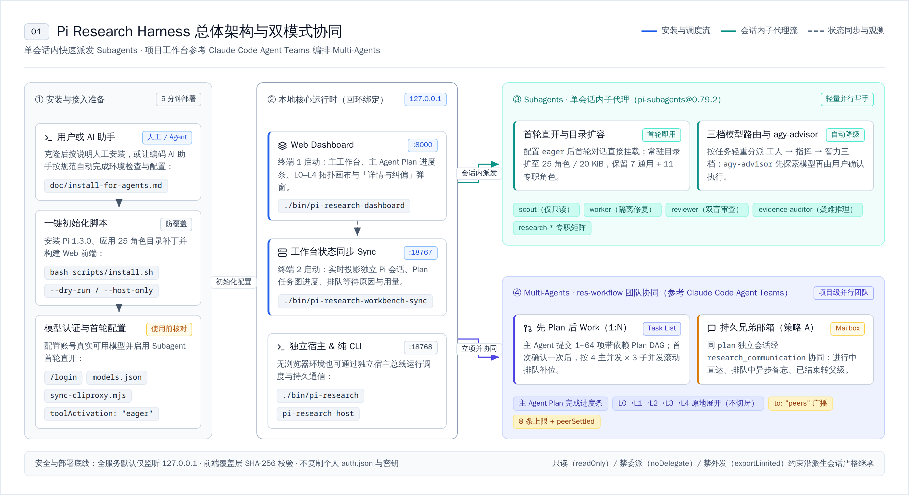
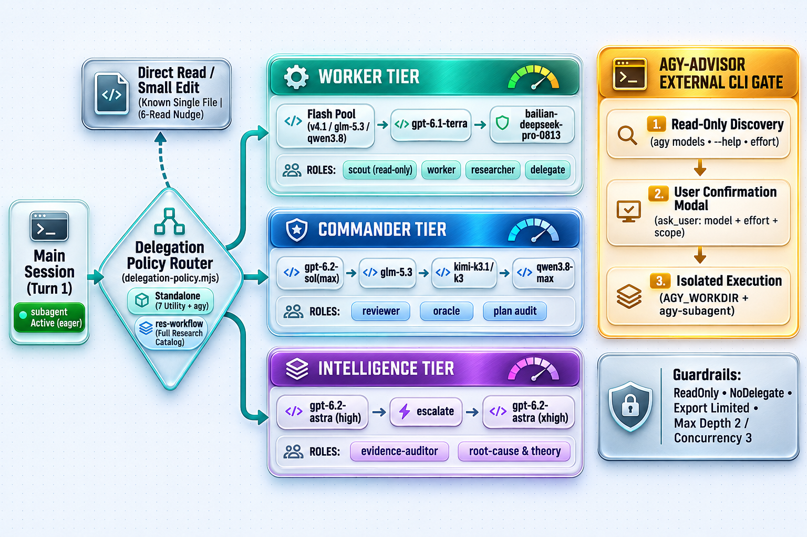
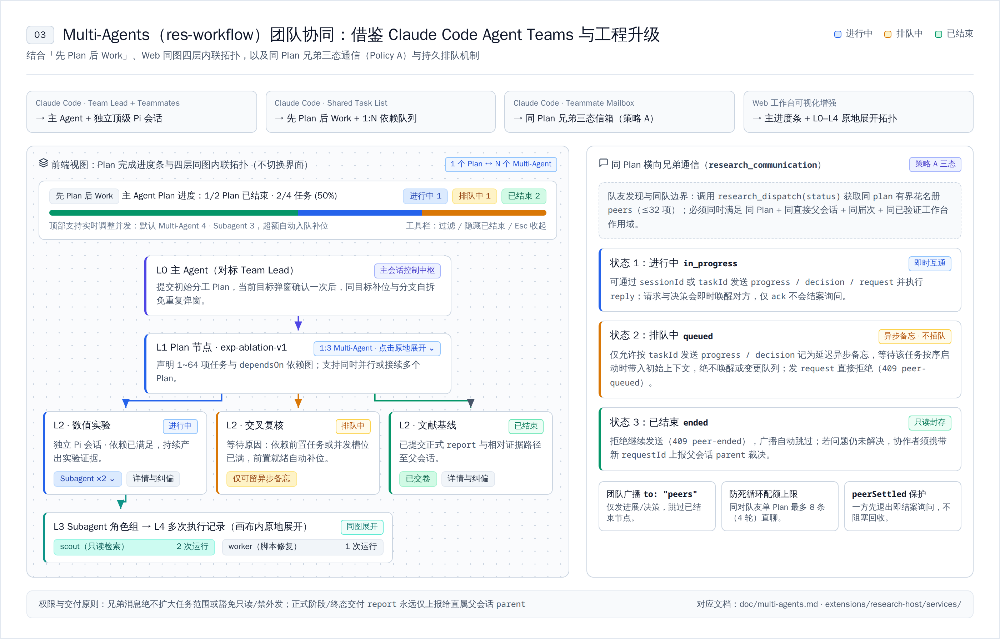

# Pi Research Harness

Pi Research Harness 是一个面向科研与复杂工程任务的 **多 Agent 协作工作台与 CLI 环境**，让你可以在同一个 Web 工作台和终端里完成：

- **单会话内快速派发 Subagents**：自动把大范围代码检索、日志排查、diff 审核、独立修改交给不同专长、不同成本档位的子代理并行处理，保持主对话清爽。
- **项目级 Multi-Agents（`res-workflow`）**：先由主 Agent 制定结构化执行计划（Plan）并经你确认，再按并发配额和依赖顺序调度多个独立 Pi 会话并行推进，并在网页拓扑图中直观查看进度与人工纠偏。
- **证据与工作流管理**：集中管理同一研究目录的会话记录、项目文件、阶段推进、主张证据和模型用量统计。

> 如需旧版历史快照，请使用 **`0.20`** 分支；当前 **`main`** 分支默认安装新版 Web 工作台、Subagents 与 Multi-Agents 编排能力。



---

## 让 AI 助手直接帮你部署（推荐）

如果你正在使用 Claude Code、Codex CLI、Cursor、Pi 或 Antigravity 等 AI 编程助手，可以直接把下面这段指令发给它，它会自动按规范检查本机环境、向你确认模型与路径并完成部署与校验：

```text
请先完整阅读 https://raw.githubusercontent.com/northkd/pi-research-harness/main/doc/install-for-agents.md
（或本仓库内的 doc/install-for-agents.md），严格按照其中的环境预检、用户确认项、安装校验、模型策略检查与启动顺序帮我部署 Pi Research Harness。
```

> 给人类用户的手把手安装与日常使用说明见下文，AI 专用部署规范见 [**doc/install-for-agents.md**](doc/install-for-agents.md)。

---

## 一、5 分钟从零安装与配置

支持 Linux 系统，需提前准备 **Git**、**Python 3**、**Node.js 22.19+**、**npm** 和 **pnpm 11.15.1**。

### 第 1 步：下载并安装

```bash
git clone --branch main https://github.com/northkd/pi-research-harness.git
cd pi-research-harness
bash scripts/install.sh
```

说明：
- 默认会将独立配置写入 `~/.local/share/pi-research-harness/agent`（如需自定义位置，可先设置 `export PI_RESEARCH_AGENT_DIR="$HOME/.local/share/my-agent"`）。
- 安装脚本会自动准备运行环境、构建 Dashboard 前端，不会覆盖或窃取你现有的个人密钥与历史对话。
- **只想用命令行、不装网页界面**，可改用 `bash scripts/install.sh --host-only`。

### 第 2 步：配置模型与 API Key（必选）

仓库本身不包含任何 API 密钥或账号登录状态，请按你自己的环境三选一配置：

1. **方式 A：交互式登录（最简单）**
   ```bash
   ./bin/pi-research
   ```
   进入终端界面后，输入 `/login` 登录你自己的大模型服务商账号，再用 `/model` 选择默认模型。

2. **方式 B：自定义 OpenAI 兼容接口（`models.json`）**
   ```bash
   AGENT_DIR="${PI_RESEARCH_AGENT_DIR:-$HOME/.local/share/pi-research-harness/agent}"
   cp "$AGENT_DIR/models.example.json" "$AGENT_DIR/models.json"
   ```
   编辑 `$AGENT_DIR/models.json`，填写你的接口地址 `baseUrl`、`apiKey`（推荐通过环境变量如 `${RESEARCH_API_KEY}` 读取）和真实可用模型 ID。

3. **方式 C：接入本机 CLIProxyAPI（如果你本机已部署 `127.0.0.1:8317`）**
   ```bash
   export PI_RESEARCH_PROXY_API_KEY="your-proxy-key"
   AGENT_DIR="${PI_RESEARCH_AGENT_DIR:-$HOME/.local/share/pi-research-harness/agent}"
   node scripts/sync-cliproxy.mjs "$AGENT_DIR" --set-default
   ```

> **⚠️ 重要提示（请务必核对模型列表）**：  
> 系统内置的 Subagent 三档调度策略文件 [`extensions/research-loop/model-policy.json`](extensions/research-loop/model-policy.json) 默认填写了 `cliproxy/...` 模型名。  
> **如果你用的是自己的 API 服务商或 `/login` 模型**，请打开 `extensions/research-loop/model-policy.json`，把 `worker` / `commander` / `intelligence` 里的模型名替换成你自己账号下真实可用的 `provider/model-id`，否则子代理调度时可能会报找不到模型或无额度。

### 第 3 步：启用 Subagent 首轮直开配置（强烈推荐）

安装脚本不会自动覆盖子代理的运行时扩展配置。新建以下配置文件后，你在对话**第一轮**就可以直接启用 Subagent（默认每个会话并发 3 个子代理、最大嵌套深度 2 层）：

```bash
AGENT_DIR="${PI_RESEARCH_AGENT_DIR:-$HOME/.local/share/pi-research-harness/agent}"
mkdir -p "$AGENT_DIR/extensions/subagent"
cat > "$AGENT_DIR/extensions/subagent/config.json" <<'EOF'
{
  "globalConcurrencyLimit": 3,
  "maxActiveAsyncRunsPerSession": 8,
  "maxSubagentSpawnsPerRun": 24,
  "maxSubagentSpawnsPerSession": 48,
  "maxSubagentDepth": 2,
  "toolActivation": "eager"
}
EOF
```

### 第 4 步：启动 Web 工作台（需开两个终端）

**终端 1 —— 启动 Web 界面与主服务：**

```bash
cd pi-research-harness
./bin/pi-research-dashboard
```

**终端 2 —— 等待终端 1 启动后，启动研究工作台同步服务：**

```bash
cd pi-research-harness
./bin/pi-research-workbench-sync
```

> **提示**：两个终端必须使用同一个账号和同一份 `PI_RESEARCH_AGENT_DIR`。如果不启动终端 2 的同步进程，Multi-Agent 与 Subagent 的实时运行进度和调度拓扑将无法同步到网页。

启动完成后，浏览器打开 **<http://127.0.0.1:8000/>**。

- 如想用命令行启动一个普通交互会话，可把 `bin/` 加入 `PATH` 后到你的项目目录下运行 `pi-research`。
- 远程服务器访问建议用 SSH 端口转发：`ssh -L 8000:127.0.0.1:8000 your-server`，不要直接将管理端口暴露到公网。

---

## 二、快速体验（可生成示例项目试玩）

如果你暂时不想拿真实科研目录做测试，可以先一键创建一个完全隔离的**本地虚构示例项目**（目录名需包含 `demo` 或 `演示`）来熟悉界面：

```bash
node scripts/create-demo-project.mjs /tmp/research-demo
```

然后打开网页，把 `/tmp/research-demo` 添加为项目，即可直观体验工作台阶段、Multi-Agent / Subagent 示例卡片和证据展示（不会消耗任何模型额度）。

---

## 三、日常如何使用（Subagents 与 Multi-Agents）

### 1. 用好 Subagents（单会话并行小帮手）

适合代码排查、日志分析、多篇文献对照、diff 复核等日常任务：
- 在对话中**正常提出需求**即可：当你让助手“通读整个仓库找某问题”“并行检查这几个模块”或明确指派（如“用 `reviewer` 检查这次改动”“调用 `agy-advisor` 给出独立意见”）时，主助手会自动匹配最合适的角色与模型档位。
- 如果使用了 `agy-advisor`（需本机提前安装并登录 `agy` CLI），它会自动拉取本机在线 `agy` 模型列表，并**弹窗向你确认具体模型、推理深度（effort）及允许发送的材料范围**后才执行。

👉 详细角色表、日常提问示例与配置排查见：[**Subagents 使用详细指南**](doc/subagents.md)



### 2. Multi-Agents（`res-workflow`）：参考 Claude Code Agent Teams 的团队协作架构

与仅在单次会话内执行轻量任务的 `Subagent` 不同，本项目的 **Multi-Agents（`res-workflow`）参考了 Claude Code Agent Teams 的“Lead + 独立 Teammates + Shared Task List + Mailbox”工程范式**，并将其进一步产品化与可视化，适合科研探索或大型多模块并行工程：

| Claude Code Agent Teams 核心理念 | 本项目（`res-workflow`）对应设计与工程增强 |
| --- | --- |
| **Team Lead + 独立 Teammates** | **主 Agent + 独立顶级 Pi 会话**：每个协作者拥有独立上下文与用量账本，内部还能继续自拆下级 `Subagent`；用户可通过 **「详情与纠偏」** 直连任意队友对话。 |
| **Shared Task List + 依赖阻塞** | **「先 Plan 后 Work」+ `1:N` Plan DAG**：主 Agent 提交 1~64 项含 `dependsOn` 依赖的任务图，首次确认一次后持久落盘排队，按实时并发（默认 `4` 主并发 × `3` 子并发）自动滚动补位。 |
| **Teammate Mailbox（队友邮箱）** | **同 `plan` 持久信箱（策略 A 三态规则）**：同队列队友经 `research_communication` 直接协同——**进行中**（`in_progress`）支持点对点请求/回复并即时唤醒；**排队中**（`queued`）仅限按 `taskId` 留异步备忘，轮到开机时可见且绝不插队；**已结束**（`ended`）拒绝再扰并转交父级；内置 `to: "peers"` 广播、单对 **8 条（4 轮）防死循环上限** 与 `peerSettled` 安全退出。 |
| **纯 CLI 黑盒协作** | **Dashboard 进度条 + 四层同图内联拓扑**：顶部实时统计各 Plan 完成度与进行/排队/结束数量；画布按 **`L0 主 Agent → L1 Plan → L2 Multi-Agent → L3 Subagent → L4 多次执行`** 展示，**点击节点直接原地展开，不切换界面**。 |

**在网页工作台里的日常使用只需 5 步**：
1. 在网页添加并打开你的项目，进入 **Agents** 页，选定（或新建）一个 **主会话（主 Agent）** 并确认目标绑定。
2. 在 **「发任务」** 中输入总目标（会自动附带「先 Plan 后 Work」引导）。
3. 主 Agent 提交结构化 **Plan** 后，在弹出的 **「确认首次科研分工」** 预览中核对依赖与分工并点击确认（不满意可直接拒绝让其调整；同一研究目标下确认一次后免重复弹窗）。
4. 在顶部观察 **主 Agent Plan 完成进度条**，并可随时微调 **Multi-Agent / Subagent 并发配额**。
5. 在拓扑画布中点击 **`Plan`** 或 **`Multi-Agent`** 原地展开下级节点，或点击任意节点右下角 **「详情与纠偏」** 直接查看完整日志与中途干预。

👉 网页每步操作说明、同 Plan 兄弟三态通信机制与 FAQ 见：[**Multi-Agents 使用详细指南**](doc/multi-agents.md)



---

## 四、常用文档索引

- **[给 AI 助手看的自动化部署指南](doc/install-for-agents.md)**（面向 Claude Code / Codex / Cursor / Pi 等 AI Agent）
- **[Subagents 与 Multi-Agents 使用手册总览](doc/README.md)**
  - [Subagents 详细教程与配置清单](doc/subagents.md)
  - [Multi-Agents（`res-workflow`）详细教程与界面操作指南](doc/multi-agents.md)
- [高级安装选项、浏览器 MCP 与多配置目录说明](docs/INSTALL.md)
- [独立宿主模式与 API 接口说明](extensions/research-host/API.md)
- [HTTPS 同源反向代理部署](extensions/research-host/deploy/README.md) · [旧版本迁移指南](extensions/research-host/migration/ROLLOUT.md)
- [主线监督设置与边界](docs/SUPERVISION.md) · [开发与测试指南](docs/DEVELOPMENT.md)
- [变更记录](CHANGELOG.md) · [许可与上游声明](NOTICE)

> 如需回退到上一版本，请检出 `0.20` 分支：`git clone --branch 0.20 https://github.com/northkd/pi-research-harness.git`。
