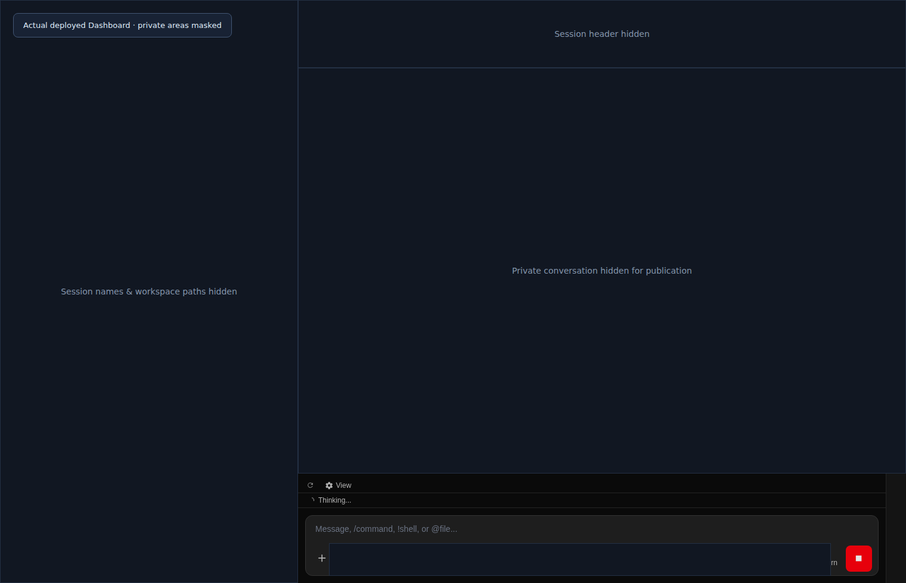
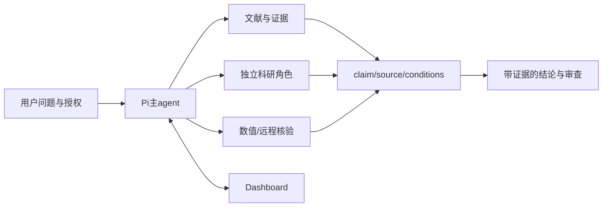

# Pi Research Harness

> 把 Pi 的科研工具、独立 agent、证据记录和 dashboard 整理成一个可保存、可复用、可二次开发的工作环境。


*中文封面由 GPT Image 生成，是概念插画，不是产品截图或科研结果。*

[](https://github.com/northkd/pi-research-harness/actions/workflows/ci.yml)


**这是一个开发者快照，不是另造一套无限维护的 agent 平台。** 现有 Pi 承担会话、工具和执行；本仓库只提供必要的科研集成、可移植配置、角色和已部署 dashboard 定制。

仓库初始为**私有**。获得访问权限后可以克隆；自己的代码采用 Apache-2.0，上游 dashboard 补丁中的原始代码保留 MIT 条款。没有模型凭据、浏览器登录信息、论文原始数据或私人聊天记录。

## 能做什么

- **科研工作入口**：独立 agent 配置目录启动，不污染个人 Pi 配置。
- **证据优先**：文献/search/fetch observations、来源定位、claim conditions与原始结果可追踪。
- **有边界的任务分工**：理论、文献、数值、匿名批评、网页模型、SSH各有明确角色；是否派发和外发材料由当前授权决定。
- **Feynman ↔ ARIS薄集成**：Markdown草稿是输入，不等于LaTeX/PDF；内部review不冒充独立审查。
- **Dashboard定制**：科研会话与native子任务展示、布局和已部署的最后消息“撤销并编辑”。
- **可选能力**：专用Chrome MCP、用户配置的GPT-image接口、agy外部CLI和远程/HPC适配。

## 子代理如何连接推理与计算


主智能体拆解问题并综合判断；科研子代理进行数学／物理推理、独立复核与数值验证。远程计算须先确认权限和资源，再通过 SSH 与调度器提交、监控作业，保留原始输出与日志，将结果回流核验理论。

*本图在网页版 Pro 会话中生成，为功能示意，不是已完成实验的证据。原始 PNG 为 1672×941，未放大、非原生 4K；不表示所有远程环境已配置或验证。*

## 实际 dashboard



*来自本机真实运行的 dashboard，截图遮罩说明与公开静态标签已中文化。为保护隐私，侧栏、会话头部、聊天区域和模型选择被不透明遮罩完整遮住，因此这里只展示布局与输入区，不是完整功能演示；没有修改实际产品或会话。*

### 发错消息：撤销并编辑


*实际按钮局部截图；采集时模型仍在运行，按钮呈禁用态。没有点击或修改真实会话。*

只处理当前会话最后一条用户消息：

1. 先停止模型和工具。
2. 点击 **撤销并编辑**，原文回到输入框。
3. 修改后自行重发；旧回复退出当前活动分支。

**不会撤销已经执行的命令、文件修改或外部操作。** 原始持久会话历史仍保留。
当前实现对无回复第一条消息、连续用户等不能安全导航的结构会明确拒绝，不宣称支持任意历史编辑。

## 五分钟理解安装路线

```bash
git clone https://github.com/northkd/pi-research-harness.git
cd pi-research-harness

# 离线检查，不需要认证模型
npm test
npm run check:release
bash scripts/install.sh --dry-run

# 新建隔离科研agent，不覆盖原个人配置
bash scripts/install.sh
export PATH="$PWD/bin:$PATH"
pi-research
```

首次启动在Pi里执行 `/login`、`/model`。选择自己真实可用的模型；本仓库不复制作者的provider/auth。

需要dashboard定制时：

```bash
bash scripts/prepare-dashboard.sh --dry-run
bash scripts/prepare-dashboard.sh
```

该步骤按固定上游提交应用补丁并构建；**不会自动启动、reload或重启服务**。
配置bridge并启动方式见 [安装指南](docs/INSTALL.md)。

## 项目结构

```text
integration/       evidence adapters、route/gate、workflow、离线测试
agents/            research-*角色模板，不绑定作者模型账号
extensions/        undo-last、可选环境变量认证的绘图工具
bin/               pi-research、dashboard、专用浏览器与agy入口
config/            安全模板、可选service模板、固定版本和源码hash
scripts/           独立安装、上游补丁检查、发布文件审计
patches/dashboard/ 正在使用的前端/native bridge源码差异
vendor/licenses/   上游原许可证
docs/              安装、开发、能力边界、截图来源
```

## 工作方式



独立视角不等于正确性保证；路由`ready`不等于审查通过；后台启动成功不等于实验完成。
对于未知model identity、缺失工具、未完成证明义务，输出blocked/provisional，而非编造完成状态。

## 当前版本保存了什么

| 已保存/验证 | 不应误读为 |
|---|---|
| 可运行的自有集成代码和离线契约测试 | 已证明所有真实科研结论正确 |
| 可移植安装配置与临时目录验证 | 在任意新机完成有认证的全量安装 |
| 已部署dashboard前端及native bridge源补丁、固定commit与hash | 打包所有node_modules/本机dist/私人状态 |
| 最后消息撤回编辑的定向测试；运行前端资源已上线核验 | 所有网络重连/历史分支场景都已完善 |
| 合成封面与脱敏真实截图 | 科研实验结果或未公开的真实聊天内容 |

**暂停的 B1/R4 完整历史重放后端不在本发布版中。** 这样保留当前可用功能，也避免把未验收的大改误当作稳定版。后台重启可中断同control group里的Pi；生产部署必须用独立执行器与备份，不在普通聊天里盲重启。

## 换设备与迁移

**当前仓库不是整机备份，不能保证“克隆后只配模型就与本机完全无缝一致”。** 核心集成、角色模板与部分 dashboard 源补丁已保存；浏览器登录、SSH／调度环境、外部技能、额外插件及私人会话／记忆／研究数据仍需单独配置或安全迁移。具体一致部分、缺口与验收顺序见 [迁移核验说明](docs/MIGRATION.md)。

## 文档与二次开发

- [安装与本地认证](docs/INSTALL.md)
- [新设备迁移核验](docs/MIGRATION.md)
- [二次开发与补丁约定](docs/DEVELOPMENT.md)
- [上游与许可证](docs/UPSTREAMS.md)
- [实际验证与未验证边界](docs/VALIDATION.md)
- [科研集成说明](integration/README.md)
- [安全边界](SECURITY.md)
- [贡献指南](CONTRIBUTING.md)
- [版本记录](CHANGELOG.md)

```bash
npm test
npm run check:syntax
npm run check:release
```

默认不运行昂贵实验、不启动后台模型评测、不提交HPC作业、不上传研究材料。
通过环境变量和独立agent目录配置认证，永远不要把真实key或cookie提交到私有/公开仓库。

## License

本项目原创部分：**Apache License 2.0**。
Dashboard上游代码/补丁上下文：**MIT**。详见 [LICENSE](LICENSE)、[NOTICE](NOTICE) 与 `vendor/licenses/`。
