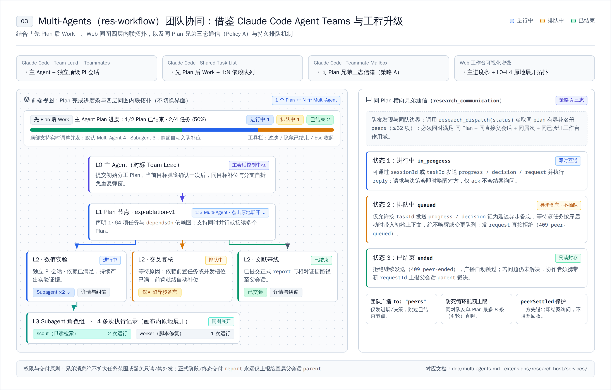

# Multi-Agents 使用指南：从启动到网页监控全流程

当你面对一个需要**多条线并行推进**的科研课题或大工程时，只在单一对话里“随手叫几个助手”往往不够清晰。**Multi-Agents（`res-workflow` 研究工作台）参考了 Claude Code Agent Teams 的「Team Lead + 独立 Teammates + Shared Task List + Mailbox」协作范式**，为每个子方向拉起**独立的 Pi 顶级会话**：



- 主 Agent（对应 Team Lead）**先制定 Plan，再启动 Work**（由你把关首轮分工）；
- **1 个 Plan 可以对应多个 Multi-Agent 任务**（对应 Shared Task List + 依赖阻塞），超出并发自动排队、前一个完成后自动补位；
- 同 `plan` 队友直接通过持久化 `research_communication` 信箱（对应 Mailbox，升级为进行中/排队中/已结束三态机制）高效协调；
- 在 Web 看板实时查看进度条、4 层拓扑关系图，并在卡片上随时原地展开下级或弹窗纠偏。

---

## 一、准备工作：确保启动了两个后台服务

使用网页端工作台和 Multi-Agent 前，请确认先配置好可用模型（见 [README](../README.md)），并打开**两个终端**保持运行：

**终端 1 —— 启动 Dashboard 主服务：**

```bash
cd pi-research-harness
./bin/pi-research-dashboard
```

**终端 2 —— 等终端 1 起来后，启动工作台状态同步进程：**

```bash
cd pi-research-harness
./bin/pi-research-workbench-sync
```

> **为什么一定要开终端 2？**  
> 终端 2 的同步进程负责把本机各独立 Pi 会话的运行状态、Plan 进度和回执实时聚合给网页和工具。如果没开终端 2，项目文件夹里的静态文件能看，但网页会提示状态未同步，Multi-Agent 也无法正常追踪和渲染。

两个终端跑起来后，浏览器访问 **<http://127.0.0.1:8000/>**。

---

## 二、网页手把手实战：6 步跑通「先 Plan 后 Work」

### 第 1 步：添加项目目录

在 Dashboard 左侧添加你的科研或开发项目文件夹。  
（如果是第一次试用，建议先按 README 用 `node scripts/create-demo-project.mjs /tmp/research-demo` 生成一个虚构演示目录体验界面。）

### 第 2 步：选好主会话，确认研究目标

点击进入项目的 **Agents**（或 **研究工作台**）页面，看顶部的 **主会话控制栏**：
1. 在下拉框选择一个活跃的 Pi 会话作为 **主会话（主 Agent）**；如果没有现成会话，可点击「打开对话」或新建研究阶段会话后再选中它。
2. 如项目尚未确认目标或提示需要衔接目标版本（`charter`），按页面按钮确认当前研究目标绑定即可。

### 第 3 步：下达总任务

点击主控制栏的 **「发任务」**（也可以直接打开主会话聊天窗口发送）：
- 写清楚你最终想要什么交付、允许参考哪些目录、有哪些边界要求（例如：“*基于 `src/` 和 `data/` 评估两个备选算法：一条线补完基线对比脚本，一条线推导收敛边界，两条线齐备后找独立评审挑刺，最后汇总结论。*”）。
- 工作台会自动在任务中附带「先 Plan 后 Work」约束，提示主 Agent **先交结构化 Plan，不要一上来闷头自己全干或乱拉会话**。

### 第 4 步：审核「首次科研分工」确认框（先 Plan）

主 Agent 梳理完拆解方案后，会提交给调度器并向你弹出 **「确认首次科研分工」** 预览，里面用人话逐项列出：
- 计划编号（`planId`）、目标版本（`charterHash`）和任务总数；
- 每一项任务的 `[任务ID] 角色 · 所属阶段`、**前置依赖**（如无依赖可立即并行，有依赖则等前置做完自动拉起）以及目标摘要。

**你的操作**：
- **觉得合理**：点击 **确认**。这一步授权对当前研究目标**只需确认一次**！之后系统自动排队补位，以及各分支在自己权责内继续拆细子任务，都不会再反复弹窗打扰你（只有换新目标、越界扩范围或触发外发/远程节点时才会重新问你）。
- **想调整分工**：点击 **拒绝 / 取消**，然后直接对主 Agent 说你希望怎么增删或合并任务，主 Agent 会调整后重新提交确认。

### 第 5 步：看板上跟踪进度与拓扑图（后 Work）

批准之后，Multi-Agent 协作者就会按依赖和并发额度自动启动。网页上你会同时看到两个直观区域：

1. **主 Agent Plan 完成进度条**：
   - 未制定 Plan 前，显示「**先 Plan 后 Work / 等待主 Agent 提交执行 Plan**」；
   - 运行起来后，实时显示 **已结束 Plan 数 / 总 Plan 数**、**Multi-Agent 任务完成百分比**，以及 **进行中**（蓝）/ **排队中**（橙）/ **已结束**（绿）徽章计数。点击进度栏里的某个 Plan 胶囊，还能直接在下方画布高亮它对应的子树。

2. **四层同图内联拓扑图**（按 `主 Agent → Plan → Multi-Agent → Subagent` 展开）：
   - **`L0 主 Agent`**：最顶层根节点，里面嵌有一条迷你进度条。
   - **`L1 Plan 卡片`**：直接挂在发起它的会话下面，标出如 `1:3 Multi-Agent` 的对应关系、以及进行/排队/结束分布。
   - **`L2 Multi-Agent 卡片`**：对应具体拉起的独立 Pi 协作者会话（如果并发满了或还在等前置依赖，会显示为 **排队中** 任务卡并标明原因，如“并发槽位排队”“依赖前置任务”）。
   - **`L3 Subagent 角色组` → `L4 多次执行`**：某个 Multi-Agent 内部调用的轻量 `subagent` 按角色挂在它下面，可查看每一轮执行和 token/费用明细。

**画布常用交互技巧**：
- **点击卡片原地展开，不会跳页**：点 `L1 Plan` 可以展开/收起所属全部 `L2 Multi-Agent`；点 `L2 Multi-Agent` 可以原地展开它底下的 `L3 Subagent`；再点 `L3` 可展开多轮 `L4` 历史记录。
- **看详细聊天 / 中途人工纠偏**：想查看某个 Multi-Agent 具体写了什么对话内容、或直接对它喊话纠正，点卡片右下角的 **「详情与纠偏」**，会弹出独立详情弹窗，不影响底层画布。
- **视野与过滤**：顶部支持按 Plan ID/任务/角色关键词搜索，勾选 **「隐藏已结束」** 只盯正在跑的节点，或者点 **「图例」** 看各连线含义；空白处左键拖动画布，`Ctrl / Cmd + 滚轮` 或左下角 `＋`/`－`/`适应全部节点` 调节视野，按 `Esc` 可逐层收起当前展开。

### 第 6 步：随时调节并发配额

在工作台顶部的 **「并发配额」** 栏可以实时调整限制（修改即保存生效）：
- **Multi-Agent 并发数**：默认 `4`（同一个主会话最多同时运行 4 个独立协作者；上限可调，通常最多 `8`），其余任务安心排在队列里，前一个汇报结束后自动由系统启动下一个，不需要你或主 Agent 手动盯梢。
- **Subagent 并发数**：默认 `3`（每个协作者内部最多同时运行 3 个 `subagent`；上限可调，最多 `32`）。

---

## 三、多 Agent 之间在后台怎么协作？（你需要了解的行为特征）

在实际运转过程中，同属一个 `plan` 的多个 Multi-Agent 可以直接用 `research_communication` 工具相互配合，不需要事事都麻烦主 Agent 转述。系统专门按任务的**三种实时状态**做了严格规则保障：

1. **进行中（`in_progress`）的队友 → 直接实时沟通**
   - 协作者可以直接给同 Plan 正在工作的队友发进展、同步决策或发起轻量协作请求（`request`），请求会自动唤醒对方来回答，回答明确关联对应请求后才算解决。
2. **排队中（`queued`）的队友 → 留异步备忘，绝不插队**
   - 如果 A 正在运行、B 还在排队等并发或等依赖，A 可以给 B 留一条进展/决策**异步备忘**；服务端会存下来，**等 B 正式轮到槽位开机时再让 B 看到，既不打断当前运行队列，也不允许 B 提前唤醒插队**。如果 A 给排队的 B 发了需要立刻拍板的 `request` 询问，系统会直接拒绝，提示 A 改发备忘或直接找主 Agent 决定。
3. **已结束（`ended`）的队友 → 禁止打扰，问题升级父级**
   - 已经交付结束的 Multi-Agent 不会再被半途唤醒；团队统一广播通知时也会自动跳过已结束成员，若有遗留问题统一向上交给父 Agent 决定。
4. **防死循环与防越权保护**：
   - 同 `plan` 的同一对队友之间点对点来回最多 **8 条直接消息（4 个来回）**，聊满仍无结论就强制交回主 Agent 裁决（团队范围广播通知不占用该私聊额度）；
   - 如果沟通到一半某一方先结束了任务，未完结的询问会标为已结算（`peerSettled`）保留给主 Agent 查阅，不会让另一方因为等回复而卡死退不出进程；
   - 队友间的任何对话都不能互相扩大原本授予的目录/读写/外发权限；每个 Multi-Agent 的正式终态结果都必须交回给它的直属父 Agent 核对证据后才能采信。

---

## 四、常见问题与排查（FAQ）

| 现象 | 原因说明 | 建议操作 |
| --- | --- | --- |
| 网页一直提示工作台未同步，或新建/派发的节点不出拓扑图 | 多半是没启动终端 2 的 `./bin/pi-research-workbench-sync`，或两个终端用的 `HOME` / `PI_RESEARCH_AGENT_DIR` / `PI_DASHBOARD_PORT` 不一致 | 检查终端 2 是否报错退出；保持环境变量完全一致后重启终端 2 |
| 任务显示「排队中」很久不动 | 1) 当前已达到 `Multi-Agent` 并发配额（默认 4）；2) 它依赖的前置 `dependsOn` 任务还没完成或被阻塞 | 看卡片下方的等待提示文案；若只是配额满，可在顶部调大 `Multi-Agent` 并发数；若卡在某上游任务，点开上游任务的「详情与纠偏」查看原因 |
| 弹窗授权之后，为什么后面又多跑了几批任务没再问我？ | 这是预设的免重复打扰机制：同一个冻结研究目标（`charterHash`）内首次确认后，同目标范围的滚动补位和分支自拆会自动延续授权 | 如需立刻暂停后续排队拉起，对主 Agent 下令暂停或收紧限制（不会粗暴杀死已经跑在半路的进程）；如研究范围变了会触发新授权 |
| 主 Agent 报“当前处于只读限制”或派不出任务 | 对话中曾经下达过“只读 / 不要委派 / 停下来”指令，且后续还没被用户交互对话显式恢复 | 在主会话输入明确授权（如“现在允许继续委派并修改文件”） |
| 纯命令行（不需要网页）能不能用 Multi-Agent？ | 支持独立宿主模式 | 若不装前端，用 `bash scripts/install.sh --host-only` 安装，运行 `./bin/pi-research host help` 查看命令启动独立宿主后再开 `./bin/pi-research` |

---

## 五、附录：开发者/工具字段速查

如需通过提示词微调或脚本了解底层动作：
- **核心工具**：[`workbench-dispatch-tool.mjs`](../extensions/research-loop/src/workbench-dispatch-tool.mjs)（`research_dispatch`）、[`workbench-communication-tool.mjs`](../extensions/research-loop/src/workbench-communication-tool.mjs)（`research_communication`）、[`workbench-session-tool.mjs`](../extensions/research-loop/src/workbench-session-tool.mjs)（`research_session`）。
- **`research_dispatch` 常用 `action`**：
  - `plan`：提交 1~64 项包含 `id`、`role`、`stage`、`task`、可选 `dependsOn`（最多 12 项）的 DAG；
  - `delegate`：把复杂方向整块交给执行协调者去拆解（按需可选）；
  - `status`：查看本人归属、Plan 状态与同 Plan 有界队友列表 `peers`（支持 `view: "detail"`、`planId`、`taskId` 分页）；
  - `atomic`：声明单个不可再拆任务（需填 `reason`）；
  - `report`：由 dispatch 拉起的子会话提交终态（`completed` / `failed` / `blocked` + `summary` + 相对 `evidence` 路径）；
  - `pause` / `resume` / `cancel`：暂停新任务拉起、恢复队列拉起、取消指定 Plan 后续调度。
- **`research_communication` 常用 `action`**：
  - `send`（`to`: `parent`、同级 `sessionId`/`taskId` 或 `peers`；`kind`: `progress` / `decision` / `request`）、`pending`、`ack`、`reply`、`report`（只准发往 `parent`）、`status`。
