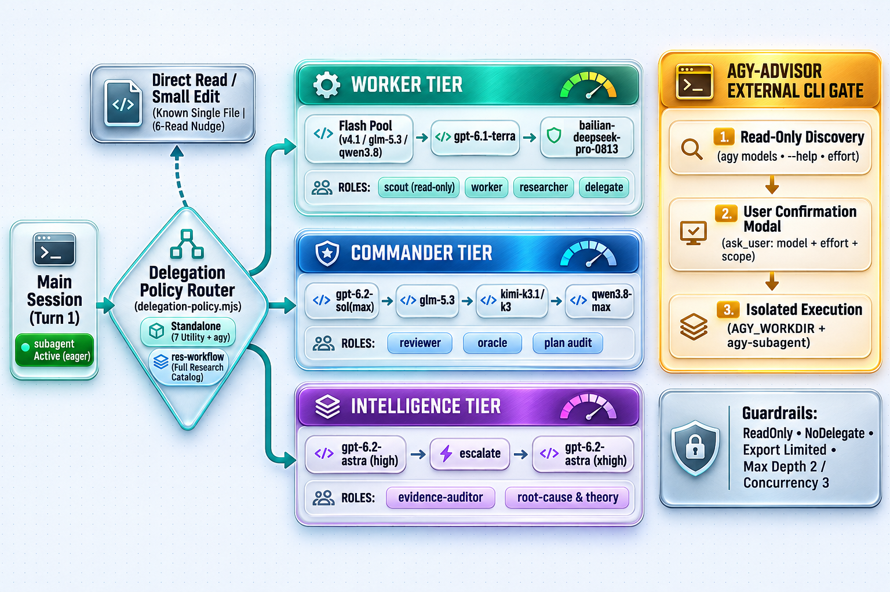

# Subagents 使用指南：配置、提问写法与外部咨询

Subagents（会话内子代理）让你在同一个对话窗口里，自动把“范围很大、可以拆开并行、或者需要换个视角复核”的工作分派给专职小帮手去做，主对话只接收精简结论与证据路径，不会被海量日志或源码刷屏。



---

## 一、从零配置（3 分钟完成）

> 本节中的 `$AGENT_DIR` 指你的配置目录，默认是 `~/.local/share/pi-research-harness/agent`（如自定义了环境变量 `PI_RESEARCH_AGENT_DIR`，请换成该路径）。

### 1. 确保配好可用的大模型 & 更新 `model-policy.json`

首先确认你已经通过以下**任一方式**让 Pi 能正常调用大模型：
- 在 `./bin/pi-research` 中用 `/login` + `/model` 登录并选好模型；或
- 复制 `$AGENT_DIR/models.example.json` 为 `$AGENT_DIR/models.json`，填入你的 `baseUrl`、`apiKey` 与可用模型；或
- 若本机运行了 CLIProxyAPI（`http://127.0.0.1:8317/v1`），执行：
  ```bash
  export PI_RESEARCH_PROXY_API_KEY="your-proxy-key"
  node scripts/sync-cliproxy.mjs "$AGENT_DIR" --set-default
  ```

**⚠️ 关键一步：检查模型分配文件 `extensions/research-loop/model-policy.json`**

通用工具型子代理（如 `scout`、`worker`、`reviewer`）不锁死模型，而是由主 Agent 按任务轻重从 [`extensions/research-loop/model-policy.json`](../extensions/research-loop/model-policy.json) 的三个档位依次挑模型：
- `worker`（工人档）：日常检索、跑脚本、小修改，追求快与省额度（默认列表优先 Flash 系列）；
- `commander`（指挥档）：代码审校、多步方案比对与宏观规划；
- `intelligence`（智力档）：疑难根因排查、顶层理论突破。

**如果 `$AGENT_DIR/models.json` 里不是预设的 `cliproxy/...` 模型名**，请直接打开仓库里的 [`extensions/research-loop/model-policy.json`](../extensions/research-loop/model-policy.json)，把 `intelligence` / `commander` / `worker` 下的 `models`（以及需要时的 `fallbackChain`）数组改成你真实能调通的模型 ID（格式通常为 `provider/model-id`，例如你在 `/model` 里看到的完整名称）：

```json
{
  "tiers": {
    "intelligence": {
      "models": ["your-provider/your-strongest-reasoning-model"]
    },
    "commander": {
      "models": ["your-provider/your-planner-or-review-model"]
    },
    "worker": {
      "models": ["your-provider/your-fast-cheap-model"],
      "fallbackChain": ["your-provider/your-backup-model"]
    }
  }
}
```

### 2. 创建 Subagent 首轮配置（必做推荐）

安装脚本不会主动写子代理运行时配置。请运行下面命令生成 `$AGENT_DIR/extensions/subagent/config.json`，开启 `"toolActivation": "eager"`，让聊天**首轮就能直接调用 `subagent`** 并限制合理并发：

```bash
AGENT_DIR="${PI_RESEARCH_AGENT_DIR:-$HOME/.local/share/pi-research-harness/agent}"
mkdir -p "$AGENT_DIR/extensions/subagent"
cat > "$AGENT_DIR/extensions/subagent/config.json" <<'EOF'
{
  "globalConcurrencyLimit": 3,
  "maxActiveAsyncRunsPerSession": 8,
  "maxSubagentSpawnsPerRun": 24,
  "maxSubagentSpawnsPerSession": 48,
  "maxSubagentDepth": 2,
  "toolActivation": "eager"
}
EOF
```

参数人话解释：
- `"toolActivation": "eager"`：第一轮对话立刻把 `subagent` 工具放出来给模型用。
- `"globalConcurrencyLimit": 3`：同时最多并发 3 个子代理，既快又不容易一下打爆 API 限流或本机内存。
- `"maxSubagentDepth": 2`：子代理最多再嵌套一层子任务，避免无限递归。

### 3.（可选）如果要用 `agy-advisor` 调用外部 `agy`

只有你想使用 `agy-advisor`、`research-agy`、`research-agy-sci` 时才需要这一步：
1. 在本机安装 Google Antigravity CLI（`agy`），默认位置应在 `$HOME/.local/bin/agy`（如果装在别处，启动 Pi 前加上 `export AGY_BIN=/你的路径/agy`）。
2. 在终端提前运行一次 `$HOME/.local/bin/agy models`，确认它能正常登录并列出可用模型。
3. 不使用 `agy` 时完全不影响其他 Subagents 和 Multi-Agents。

---

## 二、日常在聊天里怎么用？

### 方式 A：不用记名字，直接提需求（自动触发）

当你在对话框提出下面这类任务时，主 Agent 会自动决定要不要分派、派几个、选什么档位模型：

- **适合自动派 Subagent 的问题**：
  - “帮我全面排查一下 `src/` 目录下所有接口哪里没校验权限。” → 主 Agent 会并行派多个 `scout` 分片检索，只把结论带回主对话。
  - “这三个报错日志文件都很长，帮我分别定位根因再对比一下。” → 并发派子代理读长日志。
  - “写完补丁后请另找独立视角做一轮改动审查。” → 派 `reviewer`（指挥档模型）审查 diff。
- **不会乱派的情况**：
  - “帮我看看 `README.md` 第 10 行写了什么”或只改一个明确的小函数 → 主 Agent 直接读写完成，不绕弯子。

### 方式 B：直接点名指定角色（精确控制）

你也可以在提问里直接说出角色名称，例如：
- `请用 scout 帮我搜一下项目里所有数据库迁移脚本的位置。`
- `让 worker 修复 tests/a.test.mjs 里的路径报错并重跑验证。`
- `请用 evidence-auditor 用高阶推理核查这两个结论之间的逻辑矛盾。`

**常用角色速查表：**

| 角色名 | 擅长做什么 | 能不能改文件/跑命令 | 通常何时出现 |
| --- | --- | --- | --- |
| **`scout`** | 跨多目录搜源码、读长日志、梳理项目结构 | **不能**（严格只读） | 普通聊天 & 科研均最常用 |
| **`researcher`** | 查外部文档/网页资料与多源对照 | 只读/检索（受外发限制） | 查库文档、对比方案 |
| **`worker`** | 独立写脚本、修局部 Bug、执行构建验证 | **能**（需非只读状态） | 独立小开发与修测试 |
| **`reviewer`** | 独立复核代码改动、规范性与潜在 Bug | 只读评审为主 | 改完代码后双盲复核 |
| **`oracle`** | 多步骤方案对比、架构一致性检查 | 只读分析 | 做重大改动前先审一次 |
| **`evidence-auditor`** | 高难度证据链核对与疑难根因定位 | 深度审查 | 普通模型没啃下来的难题 |
| **`delegate`** | 边界清楚的通用独立子任务 | 按任务描述 | 通用独立工作 |
| **`agy-advisor`** | 通过本机 `agy` CLI 调外部强模型给第二意见 | 仅执行用户确认后的外部咨询 | 想借助本机 `agy` 生态时 |

> **如果你接入了科研工作台（`res-workflow`）**，还会解锁一排科研专职角色：`research-literature`（文献溯源）、`research-theory`（理论建模，只读）、`research-numerics`（数值/实验脚本运行）、`research-critic`（苛刻挑刺与找反例，只读）、`research-ssh`（远程集群任务）、`research-web-oracle` 等。平时工程与文件整理仍建议走上面通用角色，把科研角色留给正式科研问题。

### 方式 C：怎么用 `agy-advisor` 安全请外部 `agy` 帮忙？

在聊天里说类似：“让 `agy-advisor` 帮我看下这个思路 / 润色这段文字”时，为了保护你的隐私和费用额度，系统会严格走 **先发现、你拍板、再执行** 三步：

1. **自动发现**：`agy-advisor` 先运行只读命令查看你本机现在有哪些 `agy` 模型以及支持的 `--effort` 档位（如 `low / medium / high / xhigh / max`）。
2. **向你弹窗确认**：主对话会弹出确认询问（`ask_user`），**明确告诉你候选模型、推荐的推理档位、会发送什么材料（如仅文字提问还是带部分文件）、是否涉及未发表工作**。
3. **你同意后再发**：只有你点选/回复确认后，它才会在隔离目录里调用 `agy-subagent`；如果你还没确认，绝对不会偷偷往外发任何文件。

> 同样规则下，外部 `agy` 给出的回答只作为独立参考意见，不能擅自篡改你的工作区授权或执行越权命令。

---

## 三、怎么随时给子代理立规矩（只读 / 禁外发 / 停用）？

你可以随时用**自然语言**在对话里下约束，主 Agent 和后续派出的所有 Subagent 会自动遵守直到你明确说放开：

- **只许查不许改**：“接下来进入只读模式 / 只分析，不要修改任何项目文件。” → 系统会阻止改动工作区文件（注意：如果你只说“保护 `data/` 只读，改 `src/`”，系统也能精准识别，不会一刀切锁死 `src/`）。
- **禁止外发**：“后续禁止外发数据 / 不要调用外部模型。” → 会拦截面向外部提供商或第三方 CLI 的调用。
- **暂不用子代理**：“下面你自己直接做，不要调用 subagent。” → 主 Agent 会暂停分派并自己动手。
- **恢复**：“现在可以修改文件了 / 可以继续使用子代理。” → 在人工交互输入后才会解除对应限制（子代理自己的输出或程序报错无法伪造解锁）。

---

## 四、进阶参考（自定义配置与运维校验）

以下内容面向需要二次定制模型顺序、检查扩展补丁的用户：

1. **查看/调整默认角色属性**：全局默认角色行为见 [`config/settings.example.json`](../config/settings.example.json)（已覆盖常驻的 7 个通用角色及按需显式调用的 6 个外部 CLI 适配：`claude-code`、`codex-exec`、`cursor-agent` 及其 `-writer`）；仓库专项角色 Markdown 定义都在 [`agents/`](../agents)。
2. **自定义某次子代理的参数（给编写工作流脚本或显式调用参考）**：
   系统支持顶层显式传入 `agent`、`task`、`model`（不再使用旧式位置参数），例如：
   ```json
   {
     "agent": "scout",
     "task": "排查 packages/server/src/ 中所有认证检查入口，仅返回总结和文件路径。",
     "model": "cliproxy/ark-deepseek-v4.1-flash[1m]",
     "async": true,
     "options": { "context": "fresh" }
   }
   ```
3. **验证目录扩容补丁状态**：仓库对 `pi-subagents@0.79.2` 应用了 `patches/subagents/0012` 与 `0013` 补丁，把单会话可加载常驻角色目录上限由 16 个扩到 **25 个（20 KiB）**，防止新角色被截断。检查安装目录补丁是否完整的命令：
   ```bash
   node scripts/apply-subagents-v020.mjs "${PI_RESEARCH_AGENT_DIR:-$HOME/.local/share/pi-research-harness/agent}" --check-only
   ```

---

## 五、新手常见问题排查

| 遇到的问题 | 最常见原因 | 怎么解决 |
| --- | --- | --- |
| 对话第一轮助手说找不到 `subagent` 工具 / 提示要先解锁 | 还没创建 `$AGENT_DIR/extensions/subagent/config.json`，或里面没写 `"toolActivation": "eager"` | 按本文“一、2”节创建配置文件并重开新对话 |
| Subagent 报错模型不存在、没额度、鉴权失败 | [`extensions/research-loop/model-policy.json`](../extensions/research-loop/model-policy.json) 默认是 `cliproxy/...` 模型名，而你本机使用的是自配 API 或 `/login` 模型 | 打开 `model-policy.json` 把三档模型列表改成你自己 `/model` 里真正可用的模型 ID |
| 想调 `agy-advisor` 但报找不到 `agy` 或模型列表为空 | 本机还没安装/登录 Google Antigravity CLI，或不在默认位置 `$HOME/.local/bin/agy` | 安装并登录 `agy`，或启动前 `export AGY_BIN="/你的路径/agy"`；不用该功能可忽略 |
| 某些新增 `.md` 角色没有在常驻列表中显示 | 角色文件头缺少 `advertise: true`，或 `pi-subagents` 补丁未正常应用 | 检查对应 `agents/*.md` 文件头部，并用 `--check-only` 检查补丁状态 |
