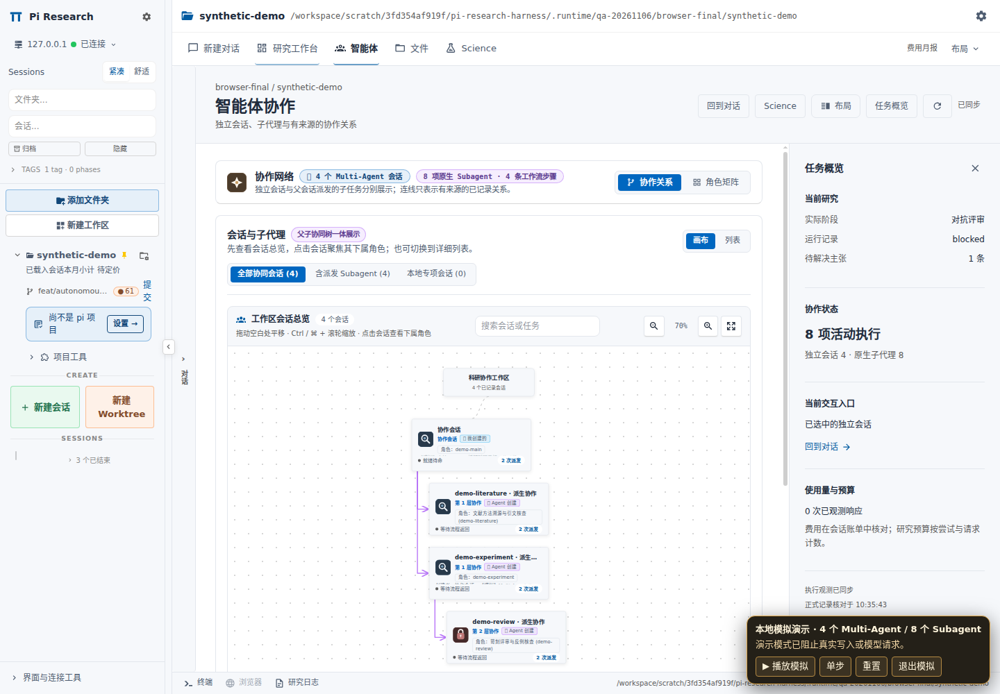
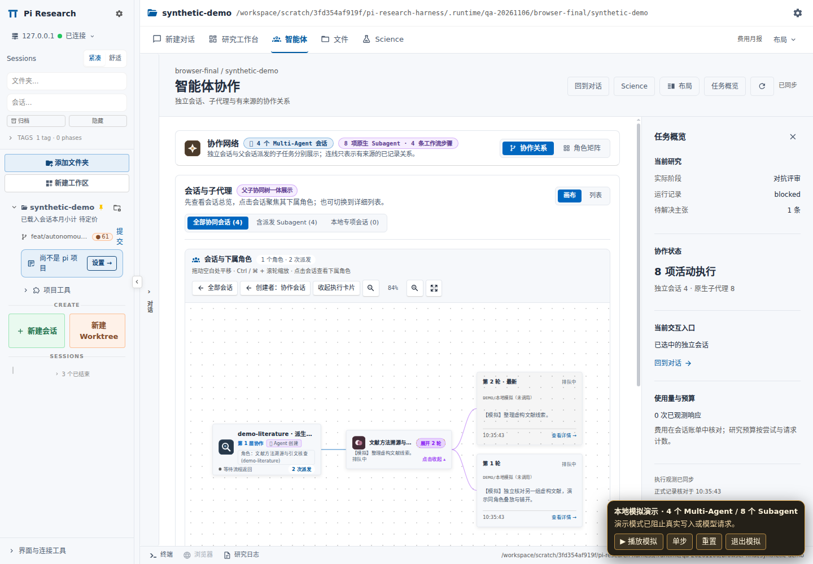
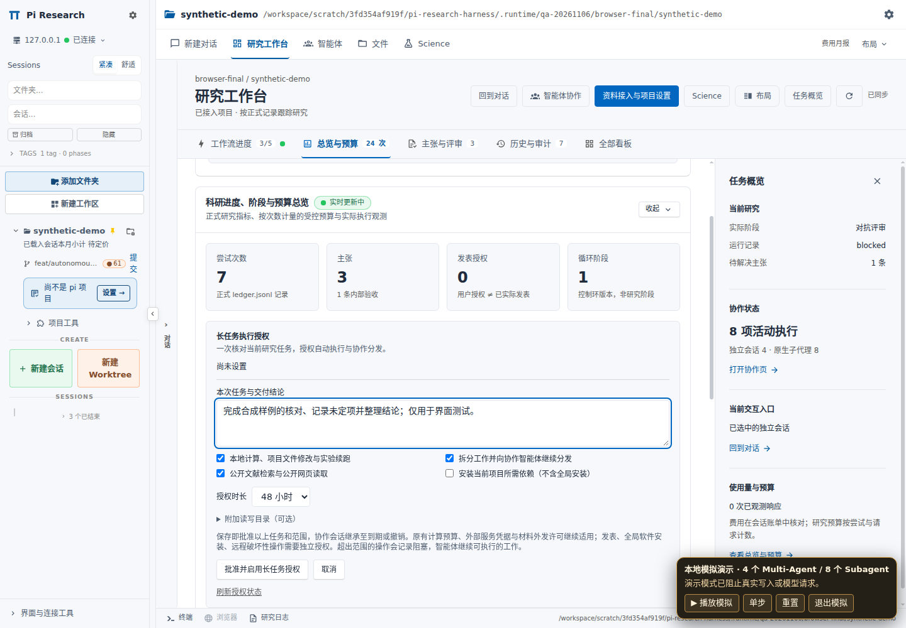

# 长任务授权、递归分发与协作画布

> 历史实施记录。当前版本使用“默认权限 / 完全访问”，恢复主 Agent 与五阶段启动入口，移除常规研究的预算前置。当前操作见[工作流控制说明](../workflow-controls/implementation.md)。下文保留旧 task-grant 设计、截图和当时验证数据，供追溯。

本次修改基于 `main` 的 `36a5540`，交付分支为 `feat/autonomous-collaboration-20261106`。Dashboard 仍以固定上游提交 `65dc4558c7b07ef755ee4f0eda89d9f63e7e76e0` 为基线。本文说明实际执行方式和验证边界；合成演示中的任务、结果和授权均不是科研运行记录。

同日后续增加了完整目标委托和有限上下文回执，详见[主 agent 上下文减负](context-offload.md)与[跟进验证](context-offload-validation.json)。本文末尾保留六项原始修改的首轮验证记录；后续的 627 文件覆盖层和 308 项 Harness 回归以跟进记录为准。

## 本次修改

| 请求 | 实现 |
|---|---|
| 滚动条过于明显 | 横向和纵向原生滚动条统一使用主题文字色的低透明度混合色；悬停、键盘焦点略微加强，保留高对比度模式 |
| 十几个小时的作业反复等待审批 | 增加限时任务授权及真实文件门控、主线监督确认接线；批准范围内自动执行，普通范围拒绝返回具体阻塞；敏感路径仍保留独立门控 |
| Multi-Agent 看起来相互独立 | 根据持久化派发来源显示创建者、层级和父子连线；支持返回创建者及查看其派生协作者 |
| 协作者收到多个工作后仍自行完成 | 协作者执行前需要提交任务计划，或为单一不可拆分任务登记 `atomic` 理由；已有结构化任务由后台执行器自动调度 |
| Prompt 分发约束不够 | 新增 `research_dispatch` 和服务端持久化依赖队列，负责创建子会话、依赖顺序、容量、回执、恢复和父会话通知 |
| 展开 Subagent 又出现第二层弹窗 | 多轮卡片在当前画布中以动效展开和收起；点击某一张执行卡片时才打开原有详情 |

## 长任务开始前怎样设置

1. 在当前项目确认研究约定并接入工作台。项目目标、成功标准、材料范围及预算仍由现有研究约定管理。
2. 打开 **研究工作台 → 总览与预算 → 长任务执行授权**，填写本次工作和交付要求。
3. 核对本地计算、协作分发、公开资料检索和项目依赖安装。默认开启前三项，项目依赖安装需要按任务需要勾选。
4. 选择 12、24、48 或 72 小时，默认 24 小时。十几个小时的任务可以选择 24 或 48 小时，为收尾和复核留出时间。需要访问项目外的数据目录时，填写具体的附加目录。
5. 点击 **批准并启用长任务授权**。同一已确认工作区的协作会话读取这份授权，无需逐个重复批准。

主 agent 应先归纳任务、检查现有授权和执行条件，把缺失的目录、依赖、凭据或资源条件集中提出；已经批准的范围直接复用。运行期间可以调整或撤销授权。撤销改变后续自动批准，不会强制杀死已经启动的计算。

授权绑定当前操作者、规范化项目目录和研究约定哈希。它对该约定下所有已加入工作区的研究协作会话共享，并非只针对某一条根任务。状态包括未设置、生效、到期、撤销和约定变更。任务描述、能力、附加目录、到期时间及最近阻塞在面板中可见。原生 `pi-subagents` 子进程若没有经过核实的工作区成员元数据，不会仅凭父会话环境变量得到额外授权；这类子进程仍遵守原有 Pi 文件访问和模型供应商权限。

服务端在会话身份和成员关系校验后消费授权；客户端不能凭一个任意 `sessionId`、目录或模型参数扩大范围。写入采用版本比较和请求幂等保护。符号链接按实际目标判断，系统、主目录及凭据目录不能通过附加目录整体授权。

普通文件路径在原有需要询问的位置查询任务授权：范围内的读写立即继续；已经进入任务授权检查的路径若遇到到期、撤销或范围不符，返回 `task-blocked`，尽力记录原因，诊断写入失败也不会改变拒绝结果。原有工作区内的放行，以及敏感或不可授予路径的独立审批，保持原有门控行为；后者仍可能要求交互，主 agent 应在启动检查时集中核对相关条件。主线监督的重复确认也可复用有效任务授权，启动时的授权提示不要求启用后台主线审查。原有硬性拒绝、明确的人工禁用及资源门槛继续生效。Shell 命令分类用于判断是否免除监督确认，**不是 Shell 沙箱**，不能证明脚本内部的每个操作都位于文件范围内。

授权记录保存在宿主私有的 `~/.pi/dashboard/research-task-permissions/`；不会修改全局 Pi YOLO 配置，也不会自动写入系统管理员权限、外部账号凭据、发布权限或新的计算预算。

## 分发执行器怎样工作

`research_session` 创建独立 Pi 进程，同时持久化它与真实父会话的关系。进程独立不表示逻辑上没有父子关系。根会话、角色、阶段、研究约定、接入记录及请求 ID 随派发保存。

`research_dispatch` 接收结构化任务图。每项任务有稳定 ID、角色、工作说明、阶段和依赖 ID。执行器校验依赖是否存在、是否成环，再创建可运行的子会话。依赖的结果通过回执传给后续任务；子任务没有提交实际结果时，不会被当作成功。

较大的目标优先由主 agent 使用 `delegate` 交给独立执行协调者，再由协调者分析和提交详细计划；主 agent 只承担目标确认、关键决策和最终验收。已有明确拆分时，主 agent 也可以直接使用 `plan`。以下是协调者或主 agent 可声明的计划示例，执行前仍需当前项目、模型和任务授权满足条件。

```json
{
  "action": "plan",
  "planId": "ablation-evidence-v1",
  "concurrency": 2,
  "tasks": [
    {
      "id": "references",
      "role": "research-literature",
      "stage": "1-idea",
      "task": "核对本次方法比较的原始文献和适用条件，保存来源与证据路径。"
    },
    {
      "id": "baseline",
      "role": "research-numerics",
      "stage": "2-experiment",
      "task": "按已批准的实验计划复现实验基线，保存配置、种子、原始输出和退出状态。"
    },
    {
      "id": "review",
      "role": "research-critic",
      "stage": "3-review",
      "task": "根据文献和基线回执检查证据缺口、反例与结论边界。",
      "dependsOn": ["references", "baseline"]
    }
  ]
}
```

协作者收到多个可分开的工作后，也使用相同工具提交下一层计划。若派发时已给出 `research_session.tasks`，后台会在该会话注册后自动建立计划，执行不依赖它再次记住某句提示词。单一不可拆分的任务使用 `atomic` 并说明原因。任务语义如何划分仍由模型判断；执行器约束已声明任务的调度和结果契约，不能自动证明模型的划分合理。

已加入工作区的根会话和受管协作者可以先进行 3 次规划读取；第 4 次读取及批量执行前，工具门控要求已有委托、计划或明确的 `atomic` 理由。决策按会话与研究约定记录，既有计划也会满足此条件，并非每条用户消息都重新做语义判断。已有待完成子任务时，协调者不能转而重复执行这些工作，或通过 `research_loop` 的运行、配置、阶段和发表操作绕过回执要求；根会话的规划与抽查读取也受限制，状态及结果上报仍然可用。

执行器保留以下默认上限，并在每次实际启动时重新核对授权和资源。等待子任务的协调者不占用可运行工作者名额，但仍计入驻留进程及内存限制。队列优先推进较深层任务，避免所有名额都被等待中的父会话占满。

| 项目 | 默认值或上限 |
|---|---|
| 每份普通计划 | 2–12 项任务；`delegate` 内部只创建 1 个执行协调者 |
| 每份计划并发 | 默认 2，最多 3 |
| 派发深度 | 根会话为 0，最多到 3 |
| 同一根任务的后代 / 已声明任务额度 | 最多 24 |
| 每个父会话的活跃子会话 | 最多 4 |
| 服务端可运行工作者 | 最多 8，含未注册的启动预留 |
| 服务端驻留协作进程 | 最多 32，含等待者和启动预留 |
| 原生会话启动可用内存 | 至少 1 GiB，同时继续满足原有主线资源门槛 |
| 新进程注册等待 | 120 秒；结果不明的启动保留占额，避免重复启动 |
| 终态回执重试 | 每 30 秒，直到收到确认 |

这些是代码中的有限默认值，不是对机器可承受并发量的承诺。来源见 [会话准入](../../patches/dashboard-v0.20/overlay/packages/server/src/res-workflow/research-session-service.mjs)及[调度执行器](../../patches/dashboard-v0.20/overlay/packages/server/src/res-workflow/research-dispatch-service.mjs)。

执行记录写入宿主私有的 `~/.pi/dashboard/res-workflow/dispatch/`。相同计划和请求 ID 的重试复用已有记录；相同 ID 对应不同内容会被拒绝。写盘成功后才释放工作者名额，防止结果只在内存中成功而落盘失败。

子会话使用 `report` 提交 `completed`、`failed` 或 `blocked`，并附真实摘要和相对证据路径。等待中的孩子不会因父会话想结束而变成完成；已有失败也不能被上层 `completed` 覆盖。会话处于 idle 本身不构成成功回执。子会话结束但没有上报时，扩展最多追加两次补报提醒，之后登记明确的阻塞结果。`cancel` 会取消后续排队工作并向下传播取消，不能被理解为已经杀死驻留进程或外部计算；结果不明的进程仍保留占额。

终态通知携带稳定标识，并等待原生 `prompt_received` 确认；没有确认会按固定间隔重试，父会话读取状态也可确认收到结果。服务重启后读取持久记录并核对实际会话，不因一次超时就重复启动不确定是否已存在的进程。注册失败、进程退出或丢失会产生明确错误及阻塞结果。任务结果恢复不等于能够复活已经终止的外部计算。

## 画布中的关系与展开

会话总览展示派发层级。每张派生会话卡片显示创建者和深度，实线箭头连接真实的父会话和其创建的协作者。普通工作区分组与任务交接采用不同表现；共享一个目录、角色名称相近或恰好出现于同一时间，都不会被推断成父子关系。缺失父记录、冲突和循环关系按异常数据处理。

聚焦一个会话后，可以查看其角色组。一个角色具有多次执行时，点击堆叠卡片后各轮执行在画布中展开；收起时返回原位置。桌面采用横向布局，窄屏采用纵向布局，保留平移、缩放和键盘导航。系统设置减少动效时直接切换状态。展开本身不会创建第二层对话框，执行详情入口仍然可用。

以下截图来自 2026-11-06 最终实际构建与原生服务部署；会话、任务、结果及授权使用明确标记的合成演示。







[360px 画布展开](screenshots/13-subagents-spread-360.png) · [启用后的授权状态](screenshots/14-task-authorization-1440.png) · [深色主题与滚动条](screenshots/09-workbench-dark-1440.png)

## 部署与复现

检出本分支后，使用现有固定版本安装和覆盖层流程。已有运行目录不要直接覆盖，先准备新的 Dashboard 目录，再按自己机器的服务配置切换并重启 Dashboard 和需要更新的 Pi 会话扩展。

```bash
git fetch origin
git switch --track origin/feat/autonomous-collaboration-20261106

export PI_RESEARCH_DASHBOARD_SOURCE="$PWD/.runtime/dashboard-autonomous"
NODE_OPTIONS=--max-old-space-size=4096 bash scripts/prepare-dashboard.sh
node scripts/apply-dashboard-v020.mjs "$PI_RESEARCH_DASHBOARD_SOURCE" --verify
```

如果本地已存在该分支，使用普通 `git switch feat/autonomous-collaboration-20261106`。准备目标必须尚不存在。Dashboard 启动器已经传入 `PI_RESEARCH_LOOP_ROOT`；后端解析器现在校验并使用这个绝对路径，修复了源码布局下找不到研究后端的问题。现有独立服务配置也需指向同一份研究扩展。

实际 UI 检查可以用新的输出目录重放：

```bash
PI_UI_BROWSER_EXECUTABLE=/absolute/path/to/chromium \
node scripts/ui-preview/launcher.mjs run \
  --runtime "$PI_RESEARCH_DASHBOARD_SOURCE" \
  --output "$PWD/.runtime/autonomous-ui-check"
```

启动器使用临时用户目录、本地原生认证和真实 HTTP 服务，结束后清理自己启动的进程。它不连接用户现有会话，不调用付费模型。演示授权 API 只改变模拟状态；真实授权与文件门控另由后端和扩展测试核验。详见 [隔离检查说明](../../scripts/ui-preview/README.md)。

## 首轮已完成的验证

最终检查使用 Linux、Node 24.22.1、pnpm 11.25.0 和 Chromium 141.0.7390.37。实际构建使用 4 GiB Node 堆；默认 2 GiB 在此环境下不足。原生服务通过本地认证，前后端插件注册清单匹配，结束后已清理本次启动的服务和浏览器。

| 检查 | 实际结果 |
|---|---|
| Harness 离线测试 | 265 / 265 通过，无跳过 |
| 主线监督离线测试 | 64 / 64 通过，无跳过 |
| 画布与投影定向测试 | 31 / 31 通过 |
| 原生文件路径门控 | 39 / 39 通过 |
| 后端定位、授权及原有 YOLO 事件接线 | 10 / 10 通过，隔离测试关闭 mDNS |
| 主线监督 adapter | 27 / 27 通过；Node 原生 TypeScript 加载、模拟 Pi bus/UI，并包含实际磁盘授权回归 |
| 执行器独立复核 | 11 / 11 通过，已包含在 Harness 265 项内 |
| 实际构建 + 原生部署 + 浏览器 | 构建成功；浏览器 29 / 29 通过，无意外 API 失败 |
| 覆盖层 | 624 个文件校验通过，部署目录与源码一致 |
| 语法与发布材料检查 | 通过 |
| 完整 TypeScript 检查 | 未通过：61 条既有诊断、5 个文件；相对已保存基线没有新增诊断，消除 4 条 |

执行器复核使用真实服务逻辑和磁盘账本、替代的进程启动与消息传输，覆盖三层共 21 个逻辑会话、并发上限、重启恢复、回执确认、写盘失败、注册丢失、启动前拒绝及取消传播。adapter 的临时测试副本只替换宿主加载入口，不代表真实 Pi SDK 或模型运行验收。各组测试有交叠，不能相加成唯一测试总数。

浏览器实际检查了五个主视图、未发送消息与未保存编辑、三层协作来源、父会话导航、正常及减少动效模式下的画布展开、360px 窄屏、授权编辑与撤销、费用和明暗主题。移动场景沿用现有响应式外壳重挂载行为，并通过移动导航进入智能体视图；没有声称桌面选中状态跨断点保持。

可核查的记录包括 [机器可读验证结果](validation.json)、[浏览器完整检查表](evidence/browser-report.json)、[测试输出摘录](evidence/test-summary.txt)、[完整类型诊断](evidence/typescript-diagnostics.txt)和[类型诊断对比](evidence/typescript-comparison.json)。保留了最终运行的六张重点截图；原始浏览器报告还列出了启动器临时生成的其他截图，可按上述命令重放。

## 验证边界

本次验证包含实际构建、真实服务启动及无头浏览器交互，以及授权、调度和门控回归。没有运行真实付费模型、生产服务器上的任务或连续十几个小时的科研作业。因此可以确认所测的执行契约和 UI 行为，不能承诺外部模型、凭据、HPC 调度器或任意长任务均不会失败。

任务授权不会绕过操作系统、模型供应商和远程服务的独立限制。一次批准后遇到新目标、新目录或尚未配置的外部能力，agent 应报告缺失条件并完成其余可执行工作。正式科研结论仍需对应实际原始证据。
