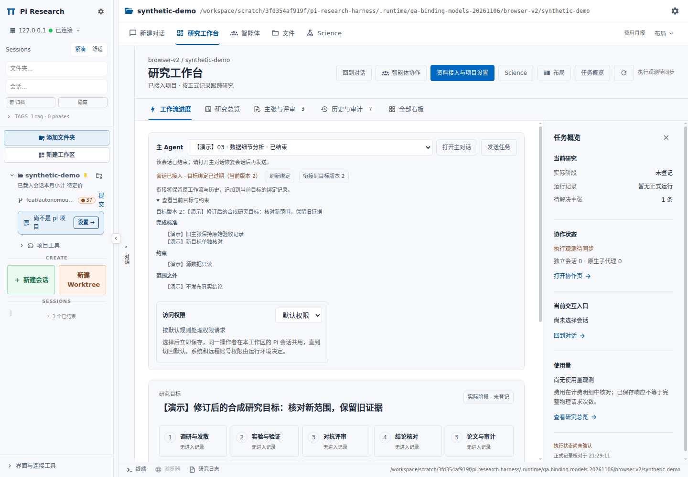
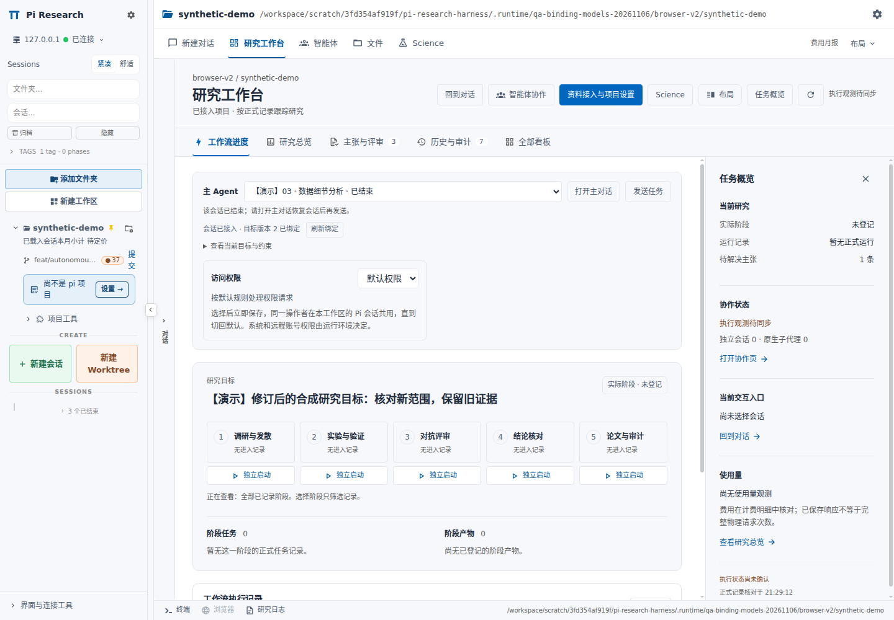

# 目标版本绑定与子代理模型选择

日期：2026-11-06。
范围：当前目标绑定衔接、原生 Pi 子代理模型保持。
分支：`feat/autonomous-collaboration-20261106`。
父提交：`9ea11f48cf71501e4c076c9a0519b91f3f28ec23`。

## 主 Agent 状态

`selected session ≠ workflow membership ≠ current charter binding`。

| 层次 | 证据 | 操作 |
|---|---|---|
| 主 Agent 选择 | 工作台保存的本项目会话 ID | “打开主对话”和“发送任务”使用所选 ID |
| 工作流接入 | 会话持久化 `resWorkflow` / `pluginRefs['res-workflow']` | 未接入会话使用菜单“并入 res-workflow” |
| 当前目标绑定 | 原确认回执、宿主私有接管记录、有效版本衔接链 | 旧绑定使用“衔接到目标版本 N” |

主 Agent 下拉选择不创建工作流成员关系。
工作流成员关系不证明目标绑定仍然有效。
界面接入状态与 `research_dispatch` 使用同一宿主证明链。

### 旧绑定的衔接

1. 主 Agent 区域显示 `会话已接入 · 目标绑定已过期（当前版本 N）`。
2. “查看当前目标与约束”展开目标、完成标准、约束、范围之外事项。
3. “衔接到目标版本 N”提交一次显式版本衔接。
4. POST 成功回执触发当前所选会话的 GET 核对。
5. GET 核对完成后显示 `会话已接入 · 目标版本 N 已绑定`。

衔接保留原 workflow 和研究历史。
衔接不新建研究目标。
衔接不启动模型、实验或分发计划。
衔接不替换“默认权限 / 完全访问”。
衔接不创建长期任务授权。
普通会话发送继续使用所选主 Agent。

### 诊断

| 状态或错误 | 含义 | 下一步 |
|---|---|---|
| `research-dispatch-session-not-joined` | 当前会话缺少有效工作流接入记录 | 使用既有“并入 res-workflow”入口 |
| `research-workbench-charter-binding-stale` | 接入存在，接管绑定仍指向旧目标 | 查看当前目标，点击版本衔接 |
| `research-workbench-assignment-stale` | 子任务仍绑定旧目标或旧分派来源 | 主会话核对范围，按当前目标重新分派 |
| `research-workbench-proof-unavailable` | 宿主证明无法完整核验 | 刷新状态，排查实际证明读取失败 |
| `research-charter-binding-conflict` / HTTP `409` | 提交前后版本或接管状态变化 | 刷新目标，再作一次显式选择 |
| 请求中断或回执无法核验 | 写入结果尚未确认 | GET 核对当前状态 |

界面显示 `目标绑定状态待核对` 时，不推断“会话未接入”。
客户端不自动重发版本衔接 POST。
客户端不把旧目录、旧主会话或旧轮询响应覆盖到当前状态。
旧确认回执缺少 revision 时，`boundCharterRevision = null`。
界面不猜测旧 revision。

## 证明链与 CAS

原确认回执：`.pi/research-loop/adoptions/<adoptionId>/confirmation.json`。
当前目标：`.pi/research-loop/state.json` 中的 `charter`。
私有衔接链：`<privateDir>/<sha256(ownerKey)>/<sha256(canonicalCwd)>/<adoptionId>.charter-bindings.json`。
默认 `privateDir`：`~/.pi/dashboard/res-workflow`。

`readResearchCharterBinding()` 验证原 receipt、私有 operation、当前 charter、完整衔接链。
链根保存原 `confirmationHash`、`confirmationReceiptHash`、`initialCharterHash`。
每次追加保存 `fromCharterHash`、`toCharterHash`、完整 `toCharter`、`previousEntryHash`、`entryHash`、`requestId`。
`bindingRevision` 按追加次序递增。
原 receipt 对应 `bindingRevision = 0`。

`GET /api/res-workflow/charter-binding?cwd=...&sessionId=...` 返回绑定状态及指定会话状态。
`POST /api/res-workflow/charter-binding` 只接收以下字段：

```text
cwd
adoptionId
expectedBindingRevision
expectedBoundCharterHash
expectedCharterHash
requestId
```

服务端从已认证请求解析 `ownerKey`。
服务端按操作者与 canonical cwd 核对写入范围。
客户端不提交 owner 证明。
`withScientificRecordLock()` 串行核对当前目标与 CAS 条件。
`updateResearchCharterBinding()` 原子保存新增链记录。
相同请求的有效重放返回现存结果。
旧请求不跨新目标版本生效。
缺少私有接管证明时，服务端拒绝衔接。

衔接保留原 `confirmation.json`、私有 adoption operation、`adopted.json`。
衔接保留研究 `state.json`、`events.jsonl`、`ledger.jsonl`。
衔接不手改旧 `charterHash`。
衔接不重置原 workflow。

### 子任务与等待计划

`inspectWorkbenchRecordContext()` 独立核对 membership 与 charter proof。
旧 `researchSession.charterHash` 保留旧任务范围。
旧子任务不因项目衔接变为主会话。
旧只读子任务继续保留只读边界。
`scopeMatches()` 核对计划的 `ownerKey`、`cwd`、`adoptionId`、`charterHash`。
旧 queued plan 不自动晋升到新目标。
主会话按当前目标重新确认需要继续的任务。

## 子代理模型选择

复现组合：Pi `1.3.0`、`pi-subagents 0.79.2`、`pi-auto-model 0.8.4`。
`pi-auto-model` 的 `session_start` 可接管子会话已解析的具体模型。
旧路径在启动时请求 DeepSeek，自动路由接管后可能实际调用 Sol。
修复保留启动时解析的具体 `provider/model`。

### 原生会话保护

`protectChildModelSelection()` 绑定当前子会话及其 stream。
`restore()` 在扩展 startup 完成后恢复已解析的模型选择。
恢复动作触发当前子会话的 `model_select`。
恢复动作不写父会话或全局默认模型。
stream 包装在 provider 请求前核对当前会话选择。
具体模型请求同时核对传入 stream 的物理模型 ID。
后续扩展更换模型触发 `model_selection_changed`。
无法解析指定模型时，原生启动拒绝 fallback。
前台 child 与后台 runner 共用此保护。

### 路由模型与核验

| 模型形式 | 行为 |
|---|---|
| 具体 `provider/model` | startup 后保持选择，发送前核验 |
| 原生 `api: pi-virtual` | 保留虚拟选择与 Pi 物理路由契约 |
| `pi-auto-model/auto` + `api: pi-messages` | preflight 返回 `model_router_verification_unsupported` |
| 请求模型与实际 response metadata 不同 | 保留 `model_verification_failed` |

legacy `pi-messages` router 缺少原生虚拟模型身份回执。
legacy router 子任务需要显式具体 `provider/model`。
legacy 拒绝发生在 provider 请求前。
模型正文中的“我是 Sol”不参与身份核验。
DeepSeek 与 Sol 不作为彼此别名。
实际 response mismatch 不因本修复放行。
父会话的自动路由继续由父会话配置控制。

## 已有安装升级

1. 更新 Harness 当前分支源码。
2. 对已有隔离 agent 执行原位 subagents 升级。

```bash
node scripts/apply-subagents-v020.mjs /absolute/path/to/agent
node scripts/apply-subagents-v020.mjs /absolute/path/to/agent --check-only
```

applier 接受完整固定上游或清单登记的完整旧补丁版本。
applier 拒绝未知改动、部分补丁或 hash 不符。
applier 不重启 Pi 进程。

3. 为 Dashboard 准备新的固定上游运行目录。

```bash
export PI_RESEARCH_DASHBOARD_SOURCE=/absolute/path/to/dashboard-next
NODE_OPTIONS=--max-old-space-size=4096 bash scripts/prepare-dashboard.sh
node scripts/apply-dashboard-v020.mjs "$PI_RESEARCH_DASHBOARD_SOURCE" --verify
```

`dashboard-next` 必须尚不存在。
`prepare-dashboard.sh` 应用当前 overlay 并构建客户端。
已有旧 overlay 目录不作为未修改上游强行覆盖。

4. 服务入口与 agent bridge 路径切换到新运行目录。
5. 在维护停点重启对应 Dashboard 服务。
6. 在安全停点重启对应 Pi 进程或会话，重新加载 `research-loop` 与 `pi-subagents`。
7. 打开原项目与原主会话，核对当前目标后衔接一次旧绑定。

已加载 native ESM 模块可能继续保留旧实现。
重建前端、刷新网页或单独 `/reload` 不保证替换已缓存 native 模块。
升级步骤不主动中断运行中的长任务。
恢复原会话不要求新建 workflow。
本次验证未操作用户生产服务或运行中的用户会话。

## 源码索引

| 路径 | 职责 |
|---|---|
| [`extensions/research-loop/src/charter-binding.mjs`](../../extensions/research-loop/src/charter-binding.mjs) | 证明链读取、追加、CAS |
| [`extensions/research-loop/src/workbench-context.mjs`](../../extensions/research-loop/src/workbench-context.mjs) | `inspectWorkbenchRecordContext()`、native 诊断 |
| [`adoption-service.ts`](../../patches/dashboard-v0.20/overlay/packages/server/src/res-workflow/adoption-service.ts) | 已认证平台衔接、会话核对 |
| [`res-workflow-routes.ts`](../../patches/dashboard-v0.20/overlay/packages/server/src/routes/res-workflow-routes.ts) | GET / POST 入口 |
| [`research-dispatch-service.mjs`](../../patches/dashboard-v0.20/overlay/packages/server/src/res-workflow/research-dispatch-service.mjs) | 等待计划范围核对 |
| [`research-charter-binding.ts`](../../patches/dashboard-v0.20/overlay/packages/shared/src/research-charter-binding.ts) | 客户端与服务端响应契约 |
| [`ResearchCharterBindingControls.tsx`](../../patches/dashboard-v0.20/overlay/packages/client/src/components/research/ResearchCharterBindingControls.tsx) | 主 Agent 状态与衔接按钮 |
| [`research-model-selection.mjs`](../../patches/subagents/support/research-model-selection.mjs) | 子代理模型保持与 preflight |
| [`config/subagents-v020.json`](../../config/subagents-v020.json) | 包版本、补丁与完整文件 hash |
| [`apply-subagents-v020.mjs`](../../scripts/apply-subagents-v020.mjs) | 固定上游安装、已有完整补丁升级、应用后核验 |

## 验证入口与边界

[`tests/research-charter-binding.test.mjs`](../../tests/research-charter-binding.test.mjs) 覆盖原回执衔接与历史保留。
[`tests/workbench-context.test.mjs`](../../tests/workbench-context.test.mjs) 覆盖成员身份、旧目标、旧子任务诊断。
[`research-charter-binding.test.ts`](../../patches/dashboard-v0.20/overlay/packages/server/src/__tests__/research-charter-binding.test.ts) 覆盖真实 adoption service 接线。
[`ResearchCharterBindingControls.test.tsx`](../../patches/dashboard-v0.20/overlay/packages/client/src/components/research/__tests__/ResearchCharterBindingControls.test.tsx) 覆盖显式 CAS、回执核对、跨 scope 响应隔离。
[`research-charter-binding-api.test.ts`](../../patches/dashboard-v0.20/overlay/packages/client/src/lib/api/__tests__/research-charter-binding-api.test.ts) 覆盖 HTTP、schema、会话回执核验。
[`tests/subagent-model-selection.test.mjs`](../../tests/subagent-model-selection.test.mjs) 覆盖模型保持和路由兼容。
[`test-subagent-model-selection-sdk.mjs`](../../scripts/test-subagent-model-selection-sdk.mjs) 使用实际 SDK 与 native drivers。

SDK 检查使用本地 synthetic provider response。
SDK 检查拦截 `fetch`，不发网络模型请求。
`zero-network stub ≠ real provider identity verification`。
离线检查不证明真实模型速度、费用、科学能力或长任务完成率。

### 本次实测证据

| 字段 | 当前记录 |
|---|---|
| 源码基线 | 当前分支工作树；父提交 `9ea11f4` |
| Harness | 375 / 375 通过；包含 15 项模型选择单测 |
| 主线监督离线回归 | 64 / 64 通过 |
| Dashboard client | 4 个 spec，39 / 39 通过 |
| 新 binding server spec | 7 / 7 通过 |
| 扩展 server 回归 | 4 个 spec，34 项；21 通过，13 项已证基线失败 |
| SDK 与 native drivers | 16 项通过；`networkAttempts = 0` |
| 生产前端构建 | web 与 team app 构建成功 |
| overlay 核对 | `files = 648`，`changed = 0` |
| TypeScript | 基线 61 条，当前 61 条；`new = []`，`resolved = []` |
| 隔离真实服务与浏览器 | 39 / 39 通过；`errors = []` |
| 原记录保留 | fixture 的 6 个原文件逐项 SHA256 不变 |
| native 上下文 | `charter-stale → ready` |
| 版本衔接结果 | `currentRevision = 2`，`bindingRevision = 1` |
| 真实模型网络请求 | 0 |
| 用户生产数据与服务器操作 | 0 |
| GitHub CI | 以[当前分支 GitHub Actions](https://github.com/northkd/pi-research-harness/actions?query=branch%3Afeat%2Fautonomous-collaboration-20261106)实际运行结果为准 |

测试组存在重叠。
本节不把各组相加为唯一总数。
完整 TypeScript 检查仍未通过。
扩展 server 回归仍包含 13 项失败。

`res-workflow-service.test.ts` 在相同 runtime 布局下，基线与当前版本均为 3 通过、13 失败。
失败名称与原因逐项一致。
失败分类：10 项旧 consent fixture，3 项 fixture 缺少 native adoption backend。
补齐 native 路径的额外控制组前后也一致。
额外控制组不混入原回归计数。

绑定浏览器检查使用真实已认证 GET / POST 与 native proof。
绑定检查覆盖旧确认回执、目标 revision 2、刷新持久化、旧 CAS 拒绝、不同会话未接入。
主 Agent 任务投递与阶段创建继续使用明确标注的模拟。
截图与项目数据均为 synthetic fixture。
本次未调用真实 LLM。

| 证据文件 | 内容 |
|---|---|
| [test-summary.txt](evidence/test-summary.txt) | Harness、client、server、构建日志节选 |
| [browser-report.json](evidence/browser-report.json) | 39 项浏览器结果、绑定状态、原文件保留断言 |
| [sdk-validation.json](evidence/sdk-validation.json) | 16 项实际 SDK / driver 检查与零网络计数 |
| [server-baseline-comparison.json](evidence/server-baseline-comparison.json) | 同布局前后失败对照、额外 native 路径控制 |
| [overlay-verification.json](evidence/overlay-verification.json) | 648 项覆盖层核验 |
| [typescript-comparison.json](evidence/typescript-comparison.json) | 当前与[上一轮基线](../workflow-controls/evidence/typescript-diagnostics.txt)的诊断对比 |
| [typescript-diagnostics.txt](evidence/typescript-diagnostics.txt) | 当前 61 条类型诊断 |





本目录只保存本轮新增的两张绑定截图。
浏览器报告保留完整回归的截图名称。
