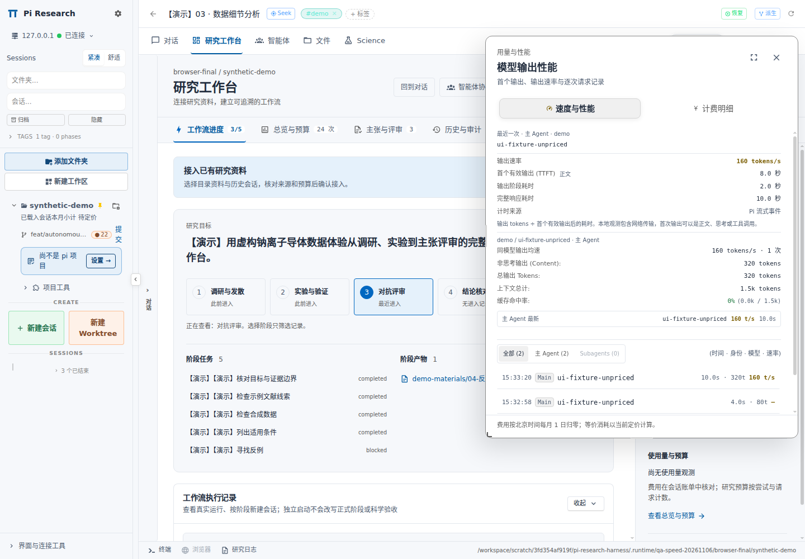
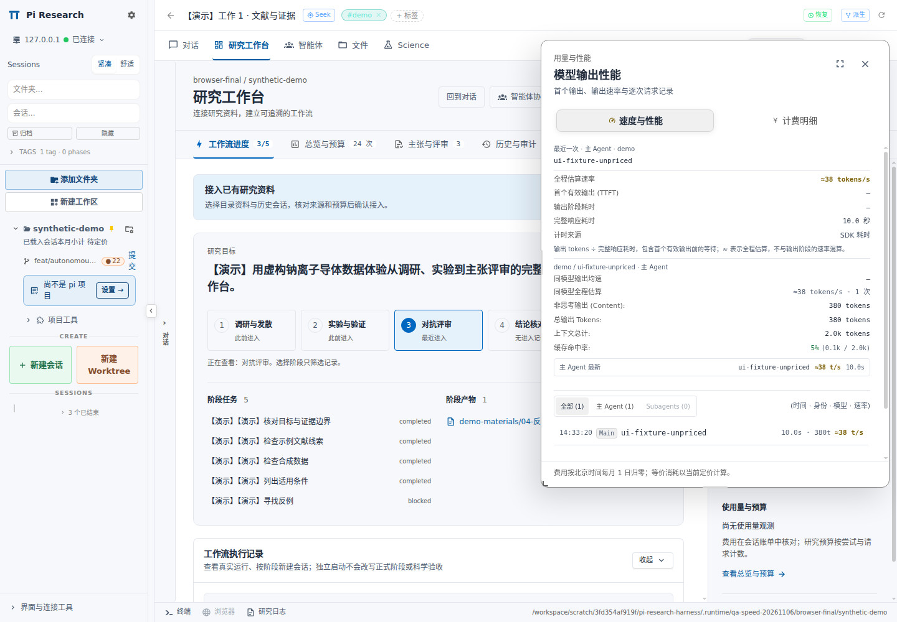

# 模型速度与性能：计时口径修正

日期：2026-11-06。
分支：`feat/autonomous-collaboration-20261106`。
本次修正覆盖 Pi 端采集、历史记录解析、速度聚合与计费面板展示。
实际验证记录见 [validation.json](validation.json)。

## 原来的速度来自哪里

计费面板请求项目自身的 `/api/speed-monitor/stats`。
后端读取 Pi 会话 JSONL，再计算速度。
原计算使用 `usage.output / ((entry.timestamp - message.timestamp) / 1000)`。
`message.timestamp` 表示请求开始；外层 `entry.timestamp` 表示会话记录追加时间。
这段时间包括首输出等待，也可能包含响应结束后的扩展处理与记录追加延迟。
缺失或反向时间曾产生 `0`，无法区分“很慢”和“没有计时”。

Pi 当前 SDK 已提供可选的单调时钟字段 `message.durationMs`。
原后端忽略了该字段。
原均速已经使用 `Σ输出 token / Σ耗时`，问题在计时窗口及混合不同模型的样本。
代码位置：[速度后端](../../patches/dashboard-v0.20/overlay/extras/speed-plugin/src/server/stats.ts)。

## CLIProxyAPI 与本次参考

当前面板没有读取 CLIProxyAPI 的服务端测速结果。
它使用 Pi 归一化后的供应商 `usage` 与本地计时。

核对的 CLIProxyAPI 提交：`c2f402b45643f0740d70b9010fd7d8d0aab7ef65`。
其内部 `usage.Record` 包含 `Latency`、`TTFT`、`Stream`；运营侧队列包含 `latency_ms`、`ttft_ms` 和 token 用量。
这些内部记录不是普通模型响应中的统一 TPS 字段。
管理接口 `GetUsageQueue` 调用 `PopOldest`，读取会消费队列记录。
本次测速保持 Pi 会话侧采集，不接管运营侧队列。
来源：[内部用量结构](https://github.com/router-for-me/CLIProxyAPI/blob/c2f402b45643f0740d70b9010fd7d8d0aab7ef65/sdk/cliproxy/usage/manager.go)、[队列字段](https://github.com/router-for-me/CLIProxyAPI/blob/c2f402b45643f0740d70b9010fd7d8d0aab7ef65/internal/redisqueue/plugin.go)、[队列读取实现](https://github.com/router-for-me/CLIProxyAPI/blob/c2f402b45643f0740d70b9010fd7d8d0aab7ef65/internal/api/handlers/management/usage.go)。

参考项目：`farion1231/cc-switch`。
固定提交：`158b2ba3045a1012baa28337d03d79bfb494c732`。
参考内容：实际请求日志的输出速度、样本门槛、观测值与历史估算的区分、时长加权聚合。
这次没有把端点连通延迟当作模型生成速度。
公式和门槛来源：[CC Switch format.ts](https://github.com/farion1231/cc-switch/blob/158b2ba3045a1012baa28337d03d79bfb494c732/src/components/usage/format.ts)。

## 新计时与公式

Pi 扩展在 `before_provider_request` 记录单调时钟起点。
首个非空文本、思考或工具调用输出标记首输出时刻；工具名称也属于有效工具调用输出。
空角色、空内容块、用量或心跳事件不构成首输出。
采集发生在 Bridge 合并文本快照与 WebSocket 传输之前。
assistant `message_end` 标记响应结束。

缓存预热可能触发同一 provider 请求钩子，但不一定产生 agent 消息。
采集器不会用预热钩子重置已在跟踪的 assistant 计时。
`message_start` 前出现多个无法明确归属的请求起点时，采集器保持请求起点与 TTFT 未知。
之后仍可独立记录首输出至结束的窗口；全程耗时按有效 SDK 或历史字段回退。

| 指标 | 计算与条件 |
|---|---|
| 首输出等待 / TTFT | `首个有效输出 - 请求开始`；没有起点或首输出时返回 `null` |
| 全程耗时 | 优先有效原生采集，再取 SDK `durationMs`，最后才用旧日志时间差 |
| 观测生成窗口 | `响应结束 - 首个有效输出` |
| 观测生成速度 `tps` | `usage.output / 生成窗口秒数`；至少 100 token，窗口至少 100 ms |
| 全程估算 `estimatedTps` | 观测生成速度不可用时，`usage.output / 全程秒数`；至少 200 token，耗时至少 1 s |
| 不可计算 | 使用 `null` 和具体原因；界面显示未记录、样本不足或计时无效 |

`usage.output` 已包含报告的 reasoning token；分子不重复相加。
全程估算包含网络、排队、首输出等待，以及请求内实际发生的重试等待。
`≈` 表示全程口径对生成速度的估算；即使 SDK 全程计时可靠，也不能把它称为首输出后的生成速率。
后端保留浮点速率，界面负责显示精度；很小的正速率不会提前舍入成 `0`。

这次增加一项保守处理：`reasoning > 0` 且首输出为正文或工具调用时，不把全部 reasoning token 除以后面的可见输出窗口。
该记录携带 `speedCaveat: "reasoning-not-observed"`，优先显示符合门槛的全程估算。
不满足估算门槛时保持不可计算。
首输出为思考内容时仍可采用观测窗口。
这是本项目针对 Pi 输出事件的适配，不代表 CC Switch 使用完全相同的采集器。

## 持久化、重放与汇总

采集器只保存计时与消息身份，不读取请求正文或密钥。
Pi 完成 assistant 消息追加后，采集器写入 `customType: "dashboard-speed-timing"` 记录。
该记录使用实际 `messageEntryId`，同时保存消息时间、provider 和 model。
后端逐项核对身份，再关联到对应的用量记录。
记录位于消息前、消息后或完整但尚无换行的文件末尾，均可关联。
相同记录重试保持幂等；冲突重复或身份不符产生计时无效。
明确无效的计时不会悄悄回退成看似有效的历史速度。
新增 custom 计时记录不进入模型对话，也不产生额外计费行。
源代码：[原生采集器](../../patches/dashboard-v0.20/overlay/packages/extension/src/generation-timing.ts)、[类型契约](../../patches/dashboard-v0.20/overlay/extras/speed-plugin/src/types.ts)。

Dashboard 历史事件重放不会重新制造实测速率。
活跃计时使用单调时钟，只展示耗时；历史均速不再作为实时 TPS 展示。
最新模型名称、provider、主/子 agent 身份与最新速度来自同一条记录。

均速仅比较最新记录的同一 `provider + model + agentType`。
观测与估算分别选取最近 30 个有效样本。
每组使用 `Σ输出 token / Σ对应窗口秒数`，样本数量独立展示。
失败或中止记录不进入正常速度均值，已发生的 token 和费用继续保留。
原人民币价表、北京时间月报、历史价格、主子分账与日志保留方式继续使用既有计费逻辑。

## 生效条件与实际边界

更新分支后，按仓库现有流程应用覆盖层并构建 Dashboard。
服务端更新需要重启 Dashboard。
原生采集器更新需要重载各 Pi 会话的 Bridge 扩展；新启动会话直接加载新代码。
只刷新网页不能补齐旧会话缺失的首输出计时。
历史记录保留原有用量；没有首输出信息的记录继续显示 SDK 全程口径或旧日志估算。

第三方扩展替换消息对象，再叠加内容遮罩替换时，个别路径仍可能丢失本轮采集记录。
这种缺失会回退到有效 SDK `durationMs` 或旧日志全程估算；缺失的 TTFT 保持未知。
有效字段也缺失时，面板显示不可计算。

这些指标描述客户端实际观测的输出过程。
代理缓冲、网络突发和未报告的隐藏思考仍可能影响结果；100 ms 门槛只能滤掉部分过短突发。
供应商未单独报告 reasoning 时，客户端不能证明隐藏思考不存在。
即使收到思考事件，也不能据此重建服务端每个 token 的真实生成时刻。
采集器不等同 GPU 内部纯解码测速。

## 已确认的验证

| 检查 | 结果 |
|---|---|
| Speed plugin | 137 / 137 通过 |
| Harness 离线回归 | 326 / 326 通过 |
| 主线监督离线回归 | 64 / 64 通过 |
| 原有扩展转发与重放回归 | 25 / 25 通过 |
| 原有共享状态重放回归 | 39 / 39 通过 |
| 生产构建与隔离原生部署 | 通过；浏览器 31 / 31 项通过 |
| Dashboard 覆盖层 | 632 个文件 |
| 完整 TypeScript 检查 | 仍未通过：61 条既有诊断，新增 0 条 |

测试组存在交叠，不合计成独立测试总数。
验证覆盖生产解析器、合成时间序列、计费保全、重放行为与界面展示。
本次没有发送付费模型测速请求，也没有测量真实供应商性能排名。
具体构建、部署、测试与剩余类型诊断见 [validation.json](validation.json)。

## 实际面板

截图来自本次实际构建与原生服务，内容为明确标注的合成记录。
第一条记录等待 8 秒、输出 2 秒，共输出 320 token；记录追加时间额外延后 10 秒。
接口与面板均显示 160 tokens/s、TTFT 8 秒、完整响应 10 秒，不把记录追加延迟混入输出窗口。

第二条记录只有 SDK 完整耗时：380 token / 10 秒，显示 `≈38 tokens/s`，TTFT 保持未知。

