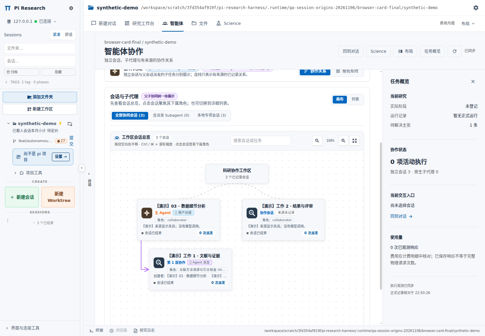

# 会话总览 100% 与创建来源

日期：2026-11-06。
范围：工作区会话总览、会话创建来源、父 Agent 关系。
分支：`feat/autonomous-collaboration-20261106`。
父提交：`4cdddff655805d6b4ba1415c2562892494d4a34b`。

## 画布缩放

“工作区会话总览”首次进入使用 `100%`。
从会话聚焦返回全部会话使用 `100%`。
布局按实际画布宽度选择列数。
总览状态、文字与拓扑更新保留用户选择的缩放比例。
放大、缩小、`Ctrl / ⌘ + 滚轮` 继续有效。
“适应画布”继续提供显式全图缩放。
单个会话的角色详情保留原有适应逻辑。

## 创建来源

`creation actor ≠ workflow membership ≠ launch channel`。

| 标签 | 记录依据 | 常见入口 |
|---|---|---|
| 用户创建 | 有效 `pi-session-creation.v1` 记录 | Dashboard 新建、手动 Fork、独立启动研究阶段 |
| Agent 派生 | 有效 `researchSession` 或观测到的直接派发关系 | `research_session`、原生子代理派发 |
| 来源未记录 | 缺少可核对的创建来源 | 未保存来源的历史会话、未声明创建者的外部启动 |

画布与列表使用相同来源规则。
`resWorkflow.via = spawn` 只描述接入方式。
`source = dashboard / tui` 只描述运行入口。
会话名称、Prompt、当前主 Agent 选择不证明创建者。
Pi JSONL 的 `header.parentSession` 可表示用户 Fork，不单独证明 Agent 派发。
“工作流创建”只保留给实际 `workflow-step` 记录。
独立 Pi 会话不因加入工作流而改贴“工作流创建”。

### 父 Agent

派生会话显示创建者名称与父子连线。
创建者文字单独保留一行。
过长角色名单行省略，悬停显示完整角色。
父会话未载入时，显示已记录的父 ID 与“未载入”。
聚焦派生会话后，可导航至已载入的创建者。
多个父关系冲突时，显示“父关系冲突”。
冲突记录不选择任意父边。
工作区分组虚线不表示创建关系。

来源查询使用实际 `sessionId`。
会话元数据缓存按 `apiBase + cwd` 隔离。
父名称查询限定同工作区。
其他主机、其他目录的同名会话不参与来源判定。

## 创建记录与历史兼容

普通新建、手动 Fork 在启动前关联精确 `spawnToken`。
独立阶段入口提交 `creationEntryPoint: "research-stage"`。
通用 REST 启动未声明阶段入口时，保留来源未知。
继续原会话保留原创建记录。
空历史 Fork 降级为新会话时，保留用户创建记录。

新增显示记录保存于 `pluginRefs['res-workflow'].sessionCreation`。

```json
{
  "schema": "pi-session-creation.v1",
  "kind": "user",
  "entryPoint": "dashboard",
  "cwd": "/absolute/project",
  "createdAt": "2026-11-06T00:00:00.000Z"
}
```

以上为结构示例，不是用户会话记录。
`entryPoint` 仅接受 `dashboard`、`research-stage`。
服务端核对注册目录与记录目录的 canonical cwd。
普通创建记录对齐实际注册目录，兼容目录别名。
新增 `sessionCreation` 只供展示，不授予权限，不创建工作流成员关系。

旧侧车顶层 `researchSession` 先核对 schema 与 canonical cwd。
已有 plugin bag 的来源记录优先保留。
兼容扫描仅向内存中的现有 `res-workflow` bag 补入同一有效记录。
后续正常保存、重连与归档沿既有 plugin-ref 流程保留记录。
扫描不批量重写历史文件。
兼容路径不补造 `resWorkflow` membership、接管凭证或目标版本。

合并继续受 `mergePluginRefBag()` 的 `16 KiB` 上限约束。
容量不足时保留原 bag，避免删除已有成员记录。
超限旧顶层记录只能在当前读取中展示。
从未记录来源的旧会话仍显示“来源未记录”。

## 更新与复验

更新当前分支的 Harness 源码。
为 Dashboard 准备新的固定上游运行目录。

```bash
export PI_RESEARCH_DASHBOARD_SOURCE=/absolute/path/to/dashboard-next
NODE_OPTIONS=--max-old-space-size=4096 bash scripts/prepare-dashboard.sh
node scripts/apply-dashboard-v020.mjs "$PI_RESEARCH_DASHBOARD_SOURCE" --verify
```

`dashboard-next` 必须尚不存在。
服务入口与 agent bridge 路径切换到新运行目录。
按维护流程重启对应 Dashboard 服务，再刷新页面。
前端构建与服务端更新需要同时生效。
只刷新网页不更新历史扫描或来源保存逻辑。
完整部署流程见[0.20 开发与部署](../RELEASE-0.20.md)。

```bash
npm test
npm run check:syntax
npm run check:release
node scripts/ui-preview/launcher.mjs run \
  --runtime /absolute/path/to/prepared-dashboard \
  --output /absolute/path/to/new-session-origin-qa
```

UI 启动器使用新的合成项目与临时用户目录。
启动器运行实际生产构建、原生服务与认证流程。
来源夹具覆盖用户创建、旧 Agent 父记录、仅有 `via: spawn` 的未知来源。
浏览器检查通过真实 rename API 验证旧来源的正常保存。
示例数据不触发模型或科研计算。

## 源码索引

| File | Purpose |
|---|---|
| [`session-creation.ts`](../../patches/dashboard-v0.20/overlay/packages/shared/src/session-creation.ts) | 创建记录 schema、目录核对、展示投影 |
| [`session-action-handler.ts`](../../patches/dashboard-v0.20/overlay/packages/server/src/browser-handlers/session-action-handler.ts) | Dashboard 新建、Fork 来源登记 |
| [`session-api.ts`](../../patches/dashboard-v0.20/overlay/packages/server/src/session/session-api.ts) | 显式阶段入口的来源登记 |
| [`event-wiring.ts`](../../patches/dashboard-v0.20/overlay/packages/server/src/event-wiring.ts) | 精确 token 注册、来源持久化接线 |
| [`participants.ts`](../../patches/dashboard-v0.20/overlay/packages/server/src/res-workflow/participants.ts) | 已接入会话保留创建记录 |
| [`session-scanner.ts`](../../patches/dashboard-v0.20/overlay/packages/server/src/session/session-scanner.ts) | 旧来源读取与正常保存兼容 |
| [`session-archive.ts`](../../patches/dashboard-v0.20/overlay/packages/server/src/session/session-archive.ts) | 归档来源保留 |
| [`ResearchAgentCanvas.tsx`](../../patches/dashboard-v0.20/overlay/packages/client/src/components/research/ResearchAgentCanvas.tsx) | 100% 默认、来源徽标、创建者导航 |
| [`research-agent-canvas-layout.ts`](../../patches/dashboard-v0.20/overlay/packages/client/src/components/research/research-agent-canvas-layout.ts) | 按实际宽度排列总览 |
| [`research-projection.ts`](../../patches/dashboard-v0.20/overlay/packages/client/src/components/research/research-projection.ts) | 来源分类、真实父关系投影 |
| [`ResearchExecutionPanels.tsx`](../../patches/dashboard-v0.20/overlay/packages/client/src/components/research/ResearchExecutionPanels.tsx) | 画布与列表共用来源、scope 缓存 |
| [`browser-qa.mjs`](../../scripts/ui-preview/browser-qa.mjs) | 实际来源 API、rename 保存、100% 浏览器检查 |

## 本次验证

| 检查 | 结果 |
|---|---|
| Harness | 381 / 381 通过 |
| 主线监督离线回归 | 64 / 64 通过 |
| Dashboard client | 4 个 spec，63 / 63 通过 |
| Dashboard server | 3 个 spec，63 / 63 通过 |
| 最终画布布局 | 9 / 9 通过 |
| 生产前端 | web 与 team app 构建成功 |
| 覆盖层 | 649 项文件核对一致 |
| 语法检查 | `npm run check:syntax` 通过 |
| TypeScript | 基线 61 条，当前 61 条；新增 0，消除 0 |
| 隔离真实服务与浏览器 | 43 / 43 通过；未预期错误 0 |
| 默认总览 | `defaultZoom = 1`，显示 `100%` |
| 来源显示 | 用户创建、Agent 派生、来源未记录均已渲染 |
| 创建者可读性 | `creatorLineVisible = true`；文字矩形位于 caption 与卡片内 |
| 历史来源保存 | 实际 rename API 保存后，父记录保留，未新增 membership |
| 原记录保留 | 7 个原研究 / 接管文件 SHA256 不变 |
| 真实模型请求 | 0 |
| 用户生产数据与服务操作 | 0 |

测试组存在重叠，不相加为唯一总数。
完整 TypeScript 检查仍未通过。
诊断对比忽略行列号，逐项比较文件、TS code 与消息。
原始诊断见[上一轮基线](../charter-binding-models/evidence/typescript-diagnostics.txt)。

登记回归使用实际 event wiring 与 fake bridge 消息。
浏览器使用预置合成来源记录、真实已认证 API 与正常侧车保存。
主 Agent 投递与阶段创建继续使用明确标注的模拟。
检查未运行真实多 Agent 科研作业。
GitHub CI 以[当前分支 Actions](https://github.com/northkd/pi-research-harness/actions?query=branch%3Afeat%2Fautonomous-collaboration-20261106)实际结果为准。

| File | Purpose |
|---|---|
| [test-summary.txt](evidence/test-summary.txt) | Harness、native client/server、布局、构建与部署日志节选 |
| [typescript-comparison.json](evidence/typescript-comparison.json) | 最终 61 条既有诊断对比 |
| [browser-report.json](evidence/browser-report.json) | 43 项检查、来源保存、100%、创建者可读性断言 |
| [24-session-origins-100-percent-1440.png](evidence/24-session-origins-100-percent-1440.png) | 实际构建、隔离合成项目、三类来源与父子关系 |



本目录只发布本轮新增的来源截图。
浏览器报告保留完整回归的 27 张截图名称。
