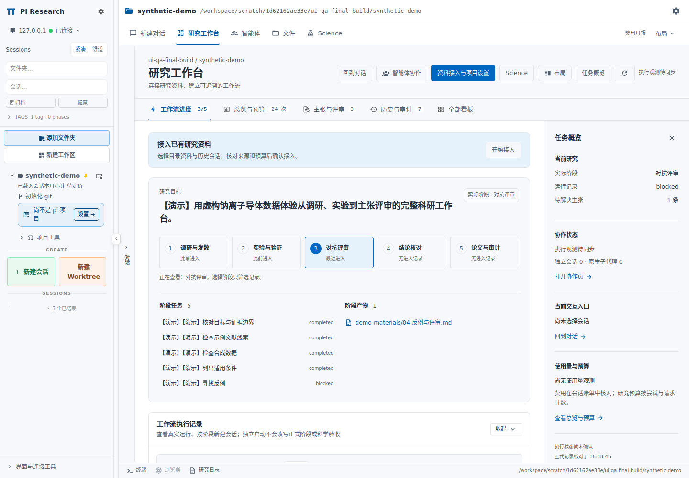
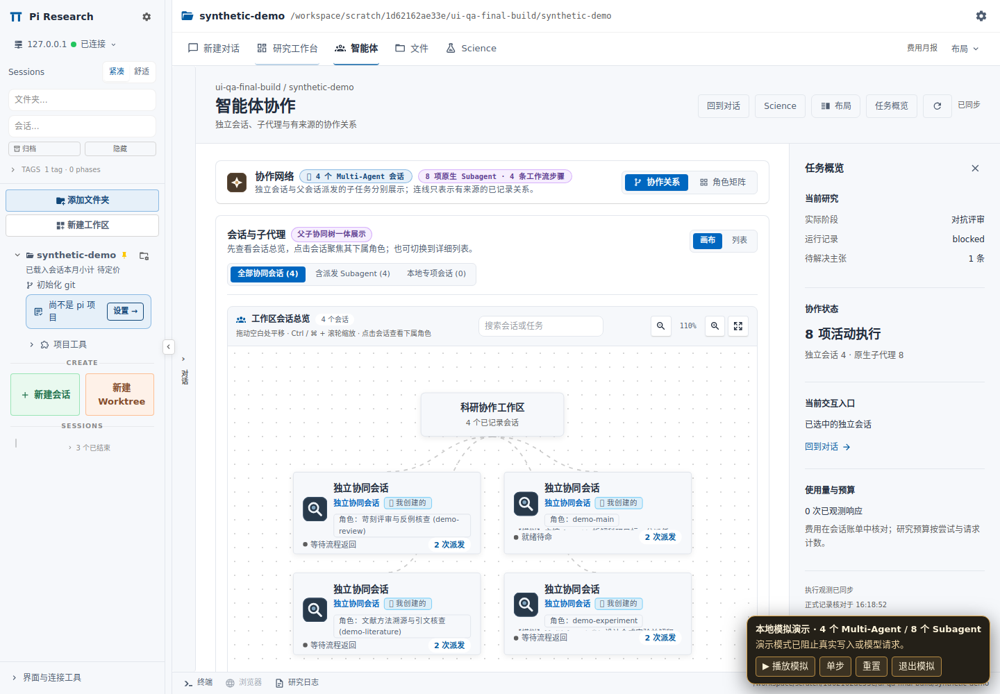
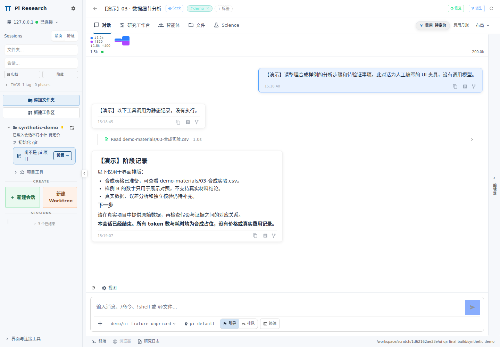
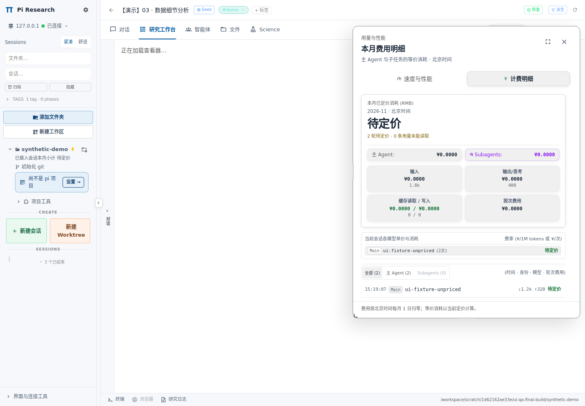

# 研究工作区 UI：实现、审查与实际验证

日期：2026-11-05。开发分支：`feat/research-workspace-ui-20261105`。基于 Harness `af2810437b39772db62201b9f86346cdb9d62dfc`，固定 Dashboard 上游 `65dc4558c7b07ef755ee4f0eda89d9f63e7e76e0`。本次修改的是 0.20 覆盖层及其部署、验证工具。

## 已完成的界面调整

| 区域 | 新布局与交互 | 保留的原能力 |
|---|---|---|
| 主工作区 | 对话、研究工作台、智能体、文件、Science 五个主视图；布局菜单集中提供分屏和比例 | 同一套会话、pane state、编辑器和旧深链接；不创建另一套运行控制器 |
| 左侧导航 | 新用户默认 248px；紧凑/舒适密度；项目工具和连接工具折叠；减少渐变及状态堆叠 | 旧宽度偏好、拖拽调整、搜索、目录、工作区、归档、工作树、完整会话菜单与插件槽位 |
| 对话 | 执行记录摘要/详细切换，失败与需要用户回答的内容保持可见 | 工具输出和自定义渲染、思考、队列、steering、停止、后台、撤销并编辑、模型与级别、Seek |
| 研究工作台 | 目标、五阶段浏览、阶段任务和产物；五个二级页签；资料接入宽抽屉；可关闭的任务概览 | 工作流、总览与预算、主张与评审、历史与审计、全部看板；接入原表单及授权流程 |
| 智能体 | 独立主视图，默认画布；列表与角色矩阵保留；执行详情和来源更明确 | 搜索、缩放、聚焦、分页、轮次、原生子代理入口、监督与纠偏 |
| 文件与工具 | 文件树和编辑获得独立空间；底部终端、已有浏览器恢复和研究日志入口 | 专用 viewer、伪标签、插件 file handler、Changes、搜索、终端创建/重命名/关闭/聚焦 |
| 用量与费用 | 跨主视图共享费用入口；右侧可调整大小、可最大化的详情；月报维度采用清晰列表 | 性能和费用标签、主/子分账、历史、模型、缓存、按次费用、筛选和月报计算 |
| Science | 主导航直达；实例、状态、产物与操作层次重排 | 无 Pi 会话入口、输入默认关闭、原 scope/lease 条件、重连、预览、原始下载与 hash |
| 主题与窄屏 | 浅色正文与辅助表面区分，保留原主题 token；任务概览按实际容器宽度决定默认状态 | 深色、自定义主题、语言、减少动画、原显示偏好；小屏仍有全部入口 |

资料接入、已访问的研究页签和有编辑状态的文件按作用域保留。关闭标签或切换项目仍释放对应状态；Science 与普通浏览器继续遵守原订阅生命周期。终端只保留一份实例，切主视图不会重新建立或终止终端。

### 明确修正的显示语义

- 研究尝试预算显示“次”，不再混用人民币符号。
- 未知价格明确显示待定价；不完整已知费用保留原不完整口径。
- 正式研究阶段和正在浏览的阶段分别显示；浏览阶段不改变研究状态。
- 独立 Pi 会话、原生 Subagent 和工作流任务记录分开显示。
- 过期观测不会被显示为实时执行；最后活动时间不作为结束时间。
- 配置技能不冒充已经观测到的工具调用；结束、验收和发表授权分别显示。
- 纠偏模板先进入可编辑草稿；没有真实会话 ID 不能伪造投递成功；API 的 transmitted 只表示已提交，界面不声称 Agent 已执行。
- 历史、评审、观测动作和子任务增加查看全部入口；手动收起的区块不被轮询反复展开。

## 功能保全审查

[原设计基线](design-spec.md) 与 [F01–F56 审计](feature-preservation.md) 一起保留。审计逐项说明新入口、原实现、测试证据和仍需真实外部后端验证的范围。

独立复核确认：22 个核心模块字节未变；App、会话卡片、会话列表和会话头部中的 13 类 Slot、19 处宿主调用未减少。此类静态比较与真实宿主回调、生命周期和行为回归一起使用，不能单独代替端到端测试。

本轮实际发现并修复的衔接问题包括：

1. 返回已编辑文档不能重置草稿或静默更新保存基线；刷新只作用于指定文件。
2. 隐藏的文件页不再抢占当前页面的快捷键；file handler 保持实例但切为 inactive。
3. 真实 App 接入 `retainAuthoring`，关闭分屏后保留需要的文件变化监听。
4. 终端隐藏时更新可见性，导航不重新 mount、不 kill。
5. 直接进入文件编辑路由后返回新建对话，先持久保存 closed 布局，再进行路由切换，避免输入框仍被隐藏。
6. 所有主视图都能访问费用；原聊天区域的重复入口去重。
7. 新部署注册 bundled `speed-monitor`，修复只有前端入口而缺少统计 API 的准备流程缺口。插件沿原生 `resources/plugins` 发现链加载，注册幂等且拒绝覆盖其他目标。

主题还补充了最后生效的 CSS 级联值与主题 manifest 的一致性检查；Monaco 使用相同的浅色色板，深色和自定义主题保持原值。

## 真实运行和无头浏览器

使用固定上游运行树安装依赖、构建真实前端和 team app，再启动原生 Dashboard CLI。服务仅绑定临时 loopback 端口，使用独立临时 HOME、原认证链和原 `setup-home.ts` 检查。没有使用用户的模型凭据或生产会话。

演示项目由仓库现有生成器生成。另写入三份合法、明确标记“【演示】”的 ended transcript：它们没有 live bridge、没有模型请求、没有价格或真实费用。复杂协作画布使用仓库已有演示模拟器，并保留画面上的演示标识。

浏览器检查覆盖：原生登录与 build registry 一致性、科研 API、旧 research/editor 深链、未发送消息、真实 Markdown 未保存草稿、文件树、已结束会话、共享费用面板、全部二级页签、接入抽屉与 Escape、1920/1440/1100/768/360px、深色主题和页面横向溢出。检查结束后停止测试服务并清理私密临时状态。

最终逐项结果见 [browser-report.json](browser-report.json)，运行环境与其他测试结果见 [validation.json](validation.json)。

### 实际页面截图

以下为真实构建的页面截图，内容是演示数据，不是用户真实研究结论或真实账单。

#### 研究工作台



#### 智能体协作



#### 对话与费用详情





[文件页](screenshots/03-files-1440.png) · [手机宽度](screenshots/08-workbench-light-360.png) · [深色主题](screenshots/09-workbench-dark-1440.png)

## 验证结果与边界

| 检查 | 结果 |
|---|---|
| 无头 Chromium 实际界面检查 | 25/25 通过；0 个未分类的页面错误；完整保留 1 条已识别 Monaco 取消事件 |
| 前端与 team app 生产构建 | 通过；本环境使用 4GB Node 堆上限 |
| 覆盖层应用和哈希 | 610 个文件；在固定上游干净工作树成功应用，再次 verify 无差异 |
| 主题、CSS 色板与对比度 | 3 文件，1139 项通过；保留原 AA 与主题层级门槛 |
| 原会话/左栏/执行记录回归组 | 33 文件，665 项通过 |
| 研究组件完整回归 | 20 文件，181 项通过 |
| 费用插件 | 7 文件，92 项通过 |
| Science 与月报 | 4 文件，50 项通过 |
| 编辑器生命周期 | 6 文件，93 项通过；行定位补充 2 文件，27 项通过 |
| 终端导航生命周期 | 1 项通过，确认单实例和明确关闭才 kill |
| 原分屏/旧链接/目录首页 | 5 文件，108 项通过 |
| 旧 ResearchPanel 集成 | 7 项通过 |
| 文件编辑路由返回对话 | 3 文件，42 项通过 |
| Harness 与监督离线测试 | 233 + 63 项通过，无跳过 |
| 语法、发布检查 | 通过；详见机器可读验证记录 |

各前端组有重叠，不能将表中所有数字相加为互不重复的总测试数。费用与科研测试同时包含原有回归和本轮新增行为验证。

### 已有问题，不能写成全仓检查通过

**TypeScript：**全仓检查仍有 65 条诊断，全部位于 6 个未改的服务端文件；本轮前端没有类型诊断。文件与原始 Harness HEAD 的字节比较和诊断分布见审计。未把“UI 构建通过”写成“全仓类型检查通过”。

**后端路由隔离：**原 `scripts/test-dashboard-v020.sh` 的 2 项检查仍失败。已使用固定上游加原始 `af2810437` 覆盖层、原测试和脚本在临时基线中重放，得到相同的 2 项失败。这不是本轮 UI 新增回归。第一项涉及原 workbench-sync 代理未遵循统一工作区访问与身份转发路径；第二项涉及安装 wrapper 的研究后端路径约定与实际解析器不一致。本次保留原服务端业务和原失败断言，未通过删测试或放宽权限来获得通过结果。具体证据见审计的已知问题章节。

**外部服务：**没有以真实付费模型、真实 Pi bridge、真实远程 PTY、Science host、普通 Browser takeover 或每个扩展服务逐一运行完整任务。上述功能有原源码复用及对应 fixture 回归，但此验证不能替代用户部署环境的连通性和实际任务验收。

浏览器报告完整保留负向 API 返回。只有原生插件状态确认 browser 为 disabled 时，其准确的未注册路由 404 才属于预期；Vault/Flows 仅对本次已验证为 ended 的合成会话，按精确响应 error 分类。其他 4xx/5xx 仍失败。Monaco 在切回预览并 dispose 编辑器时可能上报准确的 `Canceled` 取消事件；验证器只按名称、消息、Monaco cancel/dispose 栈和该检查阶段识别它，并保存完整记录。它不会全局吞掉应用错误。

## 在本机准备这个分支

Git 检出和正在运行的 Dashboard 是不同目录。下面只准备新运行树；准备脚本拒绝覆盖已有目标，不会启动或重启服务。

```bash
git fetch origin feat/research-workspace-ui-20261105
git switch --track origin/feat/research-workspace-ui-20261105

PI_RESEARCH_DASHBOARD_SOURCE="$PWD/.runtime/dashboard-workspace-ui" \
NODE_OPTIONS=--max-old-space-size=4096 \
bash scripts/prepare-dashboard.sh
```

若本地已存在同名分支，直接 `git switch feat/research-workspace-ui-20261105`。运行树目标须不存在。Node >= 22.19，pnpm 依照原发布文档准备；本次实际环境为 Node 24.22.1、pnpm 11.25.0、Chromium 134。

准备好 Playwright 浏览器后可重放 UI 检查；完整参数、隔离方式和输出说明见 [scripts/ui-preview/README.md](../../scripts/ui-preview/README.md)。

```bash
node scripts/ui-preview/launcher.mjs run \
  --runtime "$PWD/.runtime/dashboard-workspace-ui" \
  --output "$PWD/.runtime/ui-qa-run-1"
```

若浏览器位于其他目录，通过 `PI_UI_BROWSER_EXECUTABLE` 显式指定可执行文件。每次使用新的输出目录；启动器不复用上次项目。手动重新构建前端后，依原部署流程执行 `scripts/install-demo-entry.mjs` 恢复演示入口。

## 关键实现位置

- `patches/dashboard-v0.20/overlay/packages/client/src/components/split/`：主导航、分屏和共享状态。
- `…/components/session/`、`…/components/chat/`：紧凑导航、原操作入口与执行记录。
- `…/components/research/`：工作台、协作、概览、资料抽屉、Science 和语义修正。
- `…/components/editor-pane/`：作者草稿、插件 handler 和终端生命周期。
- `patches/dashboard-v0.20/overlay/extras/speed-plugin/src/`：费用详情和对应测试。
- `scripts/register-dashboard-extras.mjs`、`scripts/prepare-dashboard.sh`：费用插件注册。
- `scripts/ui-preview/`：可复现的真实服务及无头浏览器检查。
- `config/dashboard-v020.json`：全部覆盖文件的源基线和最终内容校验。
