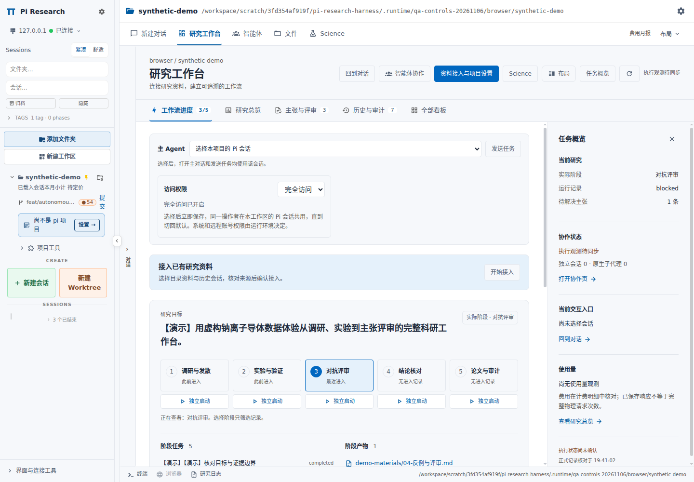
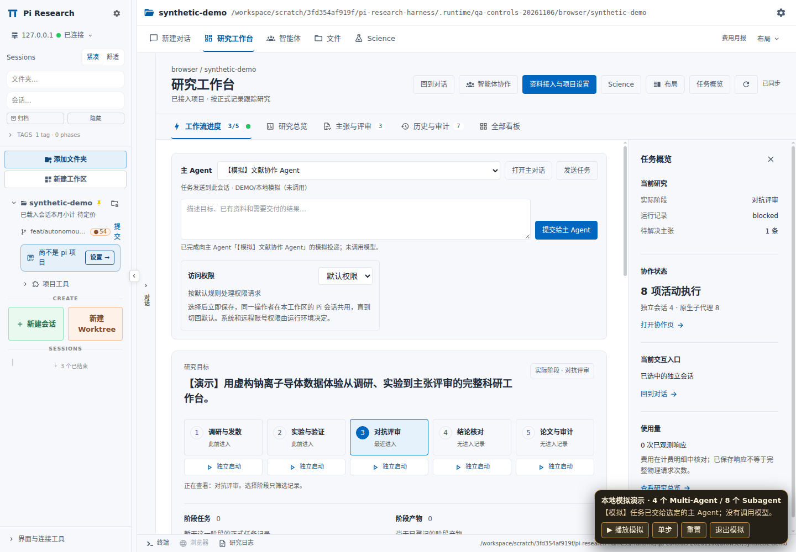
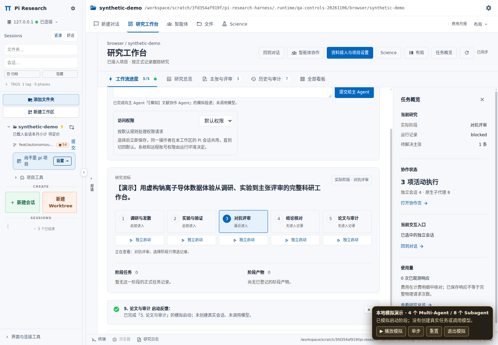

# 主 Agent、阶段启动与访问权限

日期：2026-11-06。
分支：`feat/autonomous-collaboration-20261106`。
本轮起点：`d95132295845118eef14647bb93daae9acdac74a`。
本页记录当前控制方式。
[旧授权与协作设计](../autonomous-collaboration/implementation.md)保留历史截图及验证数据。

## 操作入口

| 操作 | 当前行为 |
|---|---|
| 指定主 Agent | 选择本项目 Pi 会话；“打开主对话”和“发送任务”定位该会话 |
| 查看阶段 | 筛选该阶段记录；不启动任务 |
| 独立启动阶段 | 编辑首条 Prompt；确认后创建该阶段独立 Pi 会话 |
| 访问权限 | 选择“默认权限”或“完全访问”；选择立即保存 |
| 研究总览 | 展示正式科研记录和实际观测用量 |

## 主 Agent 选择

研究工作台和协作页顶部显示“主 Agent”。
候选限定当前规范目录、本机 Pi 会话。
首次使用记录当前活动 Pi 会话。
显式选择按 API 服务与服务端核验的规范目录保存到浏览器 `localStorage`。
目录别名与规范路径共用选择。
读取目录身份不要求研究已经接入。
刷新页面和切换视图沿用选择。
查看其他协作者不自动更换主 Agent。
选择本身不发送任务。
“打开主对话”定位所选会话。
“发送任务”提交到同一会话，并核对服务端传输回执。
已结束会话保留打开入口，恢复前禁用任务投递。
独立阶段会话沿用 Pi 默认会话配置，不自动替换主 Agent 选择。

## 五阶段入口

“工作流进度”五张阶段卡各自显示“独立启动”。
入口不依赖展开执行记录。
点击入口打开该阶段首条 Prompt 编辑区。
“确认并新建会话启动”提交新会话请求。
创建失败保留 Prompt 草稿。
查看阶段按钮继续只筛选记录。

## 启动与接续

“接续已有研究”先读取冻结目标、证据、已完成产物和运行状态。
已有任务继续观察，避免重复派发。
“新启动工作流”通过 `research_loop action="run"` 从 Stage 1 开始。
`run` 不恢复历史实验进程。
复制启动指令只准备文字，发送至 Pi 会话后才执行。
独立启动阶段创建新会话，保留原有研究记录。
阶段进入记录与阶段完成分别判定。
任务回执不构成科学主张验收。

## 常规执行无需预算设置

`research_loop run` 调用 `spawnResearchWorkflow`，使用 `subagents:rpc:v1:request` 原生 RPC。
常规路径不创建预算 scope，不要求请求额度，不注入 `researchBudget`。
`auto-research.js` 未收到 `researchBudget` 时直接运行原生子任务。
旧显式预算接口及适配器保留历史记录和用量兼容，不再执行有限额度。
旧预算文件不参与常规启动、尝试记录或健康诊断。
默认 `maxAttempts: 60` 与旧保存的 `maxAttempts` 不再触发停机。

2026-11-07 的补充更新将此策略扩展到旧显式适配器、资料接入和 Goal：预算由用户把控，实际用量继续累计，旧有限或零额度不再成为执行门槛。空闲阶段识别也取消每日请求限额。具体实现与验证见[无研究预算上限的执行策略](../research-budget-policy.md)。
这些变化在加载新版运行组件后生效；更新工作台不热替换运行中的 `modelRuntime`。已有作业先核对状态，避免为切换模式重复创建任务。

固定原生依赖：`pi-subagents@0.79.2`。
只读核对使用锁文件指定 tar 包，完整 integrity 匹配。
`src/extension/rpc.js` 原始 SHA-256 匹配[固定补丁清单](../../config/subagents-v020.json)。
原生 `spawnParams` 接受 `workflow` 文件路径、`args`、`cwd` 和 `async: true`。
原生 `handleRequest` 将 `method: "spawn"` 交给 `executeChecked`。
[本地补丁](../../patches/subagents/0002-research-budget-0792.patch)仅对显式注册的预算 binding 替换上下文；普通请求继续原上下文。
此核对确认协议兼容，不代替真实模型运行验收。

科研记录继续校验当前 `charter` 哈希。
重复 `attemptId` 继续校验科学内容。
重复尝试、连续无正信号和证据缺口继续进入诊断。
内存准入、并发、递归深度、里程碑及评审轮次工程限制继续生效。
显式停止与中止继续生效。
实验返回 `blocked` 时，流程保留阻塞并停止后续评审。
RPC 未确认启动时返回 `unconfirmed`，不自动重试创建。

## 真实用量与费用

研究总览移除预算编辑器和长任务授权表。
独立用量区域展示已观测模型响应、输入 token、输出 token。
响应计数使用“至少 N 次”。
未保存的失败和重试可能未计入。
继承历史响应单独排除，避免重复累计。
缺失记录显示未知；真实零值显示 `0`。
其他目录观测和非法计数不进入当前用量展示。
过期及部分覆盖继续显示提示。
费用保留在计费明细核对。
资料接入分析、Goal 轮数和外部供应商额度保留各自口径。

## 权限入口

“访问权限”提供 `default` 与 `full-access`。
选择按操作者与规范项目目录立即保存，直至切回默认。
模式不依赖研究接入、`charter`、任务文本或到期时间。
同一操作者的已注册 Pi 主会话、工作台协作会话和执行协调者读取该模式。
其他操作者、其他目录和远程镜像会话不继承。
无需填写任务授权表、附加目录或到期时间。
任务范围与交付目标继续通过聊天或任务提示指定。
操作系统、模型服务和远程账号权限继续由运行环境决定。

| 接入点 | 完全访问下的行为 |
|---|---|
| Dashboard 文件门控 | 当前注册会话按操作者和目录读取模式；读、写、编辑请求直接通过应用内确认 |
| 主线监督执行确认 | 普通可确认操作继续执行；明确策略拒绝和内存门槛继续生效 |
| 协作与执行器会话 | 可信 `spawnToken` 沿现有注册链传递操作者；首次任务发送前完成归属登记 |
| 切回默认 | 后续权限请求恢复普通确认；不写持久目录授权，不取消已有运行 |
| 原生 SDK 子运行器 | 未挂载上述确认门控的子运行器沿用原生执行方式；本页不将其描述为读取此开关 |

HTTP 请求只接受 `cwd`、`mode`、`expectedRevision`、`requestId`。
操作者来自认证上下文，不接受请求体指定。
目录使用现有访问检查及规范路径重验。
保存使用版本比较、进程互斥和原子替换。
崩溃遗留锁保留为不可用状态，避免删除其他写入者的新锁。
原生主线确认从可信会话上下文与宿主元数据读取归属。
`getHeader()` 支持首条转录尚未落盘的新 Pi 会话。
缺失、损坏或不匹配的身份不产生完全访问权限。
旧 task-grant 的到期、撤销和能力字段不再参与普通文件门控或协作派发。
旧 task-grant API 保留兼容，当前界面不再挂载其表单。

## 已完成定向回归

| 检查 | 结果 | 覆盖 |
|---|---|---|
| 原生启动、工作台上下文、协作提示 | 29 / 29 通过 | 无配额启动；旧零配额；61 次正进展；损坏旧预算；内存拒绝；RPC 失败；实验阻塞；科学与只读约束；上下文长度 |
| 原生权限存储 | 11 / 11 通过 | 操作者与目录隔离；持久化；版本冲突；4 进程同版本仅 1 次提交；崩溃锁不删除 |
| 权限服务与路由 | 13 / 13 通过 | 认证归属；目录访问；保存协议；注册会话权限读取 |
| 文件门控与 YOLO 链路 | 47 / 47 通过 | 新能力协商；完全访问；默认确认；旧服务兼容；断连与不可用 |
| 客户端控制与回归 | 5 文件，40 / 40 通过 | 包含权限 7 项、主 Agent / 工作流 12 项、总览 4 项；目录别名、目标投递、五阶段入口、真实用量 |
| 新 Pi 会话生命周期 | 通过，0 模型请求 | 实际 Pi 1.3.0 `SessionManager.create`；JSONL 未存在；可信 `mergeSessionMeta` 归属；`getHeader()`；`full-access` → `default` |
| 语法与差异检查 | 通过 | 新 launcher、ledger、workbench-context；`git diff --check` |

上述分组存在测试重叠，不相加作为全仓总数。
定向测试使用合成会话与本地临时项目。
定向测试不发送付费模型请求。
真实部署与全仓结果在下节单独记录。

```bash
node --test tests/research-without-budgets.test.mjs \
  tests/workbench-context.test.mjs \
  tests/research-session-context-budget.test.mjs
```

预算定向日志：`.runtime/qa-controls-budget/budget-after.log`。
总览独立 UI 日志：`.runtime/qa-controls-budget/overview-after.log`。
新会话生命周期日志：`.runtime/qa-access-backend-20261106/native-session-before-transcript.log`。
公开核验结果：[首条转录前的原生会话验证](evidence/native-session-before-transcript.json)。

## 本轮集成验证

| 检查 | 结果 | 范围 |
|---|---|---|
| `npm test`：Harness | 346 / 346 通过 | 仓库离线契约与回归 |
| `npm test`：监督离线 | 64 / 64 通过 | 原主线监督约束 |
| 主线监督 adapter | 28 / 28 通过 | 加载实际 TypeScript adapter；模拟 Pi bus/UI；无模型请求 |
| 客户端 | 40 / 40 通过 | 同上 5 文件控制与回归组 |
| 权限服务与路由 | 13 / 13 通过 | 同上服务端组 |
| 文件门控与 YOLO 链路 | 47 / 47 通过 | 同上扩展组 |
| 全量 TypeScript | 61 条既有诊断 | 对比 `d951322` 的 `(file, code, message)`；新增 0，消除 0；全量检查未通过 |
| pnpm 生产构建 | 通过 | 实际 Dashboard 运行树 |
| 源码覆盖层 | 642 项核对通过 | 当前 manifest 与运行树对应 |
| 语法与发布清单 | 通过 | 本轮代码与当前发布文件 |
| 隔离真实部署与浏览器 | 35 / 35 通过 | 原生认证；实际权限服务保存与刷新；主 Agent 和阶段启动显式模拟；0 模型请求 |

各组与定向检查存在重叠，不相加为唯一测试总数。
生产构建成功不替代 TypeScript 诊断状态。
本轮尚未运行真实付费模型或连续十几个小时的科研作业。

[完整验证清单](validation.json)保存分组、构建、覆盖层及验证范围。
[浏览器报告](evidence/browser-report.json)记录 35 项检查。
[部署摘要](evidence/deployment-summary.json)记录实际服务与生产客户端匹配。
[TypeScript 对比](evidence/typescript-comparison.json)保留 61 条既有诊断的基线比较。

## 部署画面与范围

本轮部署使用隔离 Dashboard 服务、临时用户目录和合成项目。
浏览器完成真实原生认证。
访问权限选择、持久保存和刷新读取经过实际权限服务。
主 Agent Prompt 投递和五阶段创建使用明确标注的模拟执行。
浏览器覆盖 1920、1440、1100、768、360 像素宽度及深色主题。
本轮未修改用户生产机器。







[研究总览与真实用量](screenshots/18-research-overview-1440.png) · [阶段首条 Prompt 编辑](screenshots/20-independent-stage-editor-1440.png) · [360 像素工作台](screenshots/08-workbench-light-360.png)

## 实现位置

| File | Purpose |
|---|---|
| [ResearchMainAgentControls.tsx](../../patches/dashboard-v0.20/overlay/packages/client/src/components/research/ResearchMainAgentControls.tsx) | 主 Agent 选择、会话定位、任务发送 |
| [ResearchWorkspaceSummary.tsx](../../patches/dashboard-v0.20/overlay/packages/client/src/components/research/ResearchWorkspaceSummary.tsx) | 阶段入口和任务概览 |
| [ResearchAccessControls.tsx](../../patches/dashboard-v0.20/overlay/packages/client/src/components/research/ResearchAccessControls.tsx) | 访问权限选择与保存状态 |
| [access-mode.mjs](../../extensions/research-loop/src/access-mode.mjs) | 操作者与目录绑定的权限存储、版本比较、原生会话读取 |
| [access-mode-service.ts](../../patches/dashboard-v0.20/overlay/packages/server/src/res-workflow/access-mode-service.ts) | 已认证 HTTP 访问与注册会话权限投影 |
| [research-task-path-handler.ts](../../patches/dashboard-v0.20/overlay/packages/server/src/res-workflow/research-task-path-handler.ts) | 实际文件请求与当前访问模式接线 |
| [ResearchOverviewAndBudget.tsx](../../patches/dashboard-v0.20/overlay/packages/client/src/components/research/ResearchOverviewAndBudget.tsx) | 正式科研指标和只读观测用量 |
| [ResearchStartGuide.tsx](../../patches/dashboard-v0.20/overlay/packages/client/src/components/research/ResearchStartGuide.tsx) | 启动与接续指令 |
| [workflow-launch.mjs](../../extensions/research-loop/src/workflow-launch.mjs) | 普通原生 workflow RPC |
| [auto-research.js](../../extensions/research-loop/workflows/auto-research.js) | 探索、实验、评审执行顺序 |
| [ledger.mjs](../../extensions/research-loop/src/ledger.mjs) | 尝试记录和无资金配额的健康诊断 |
| [workbench-context.mjs](../../extensions/research-loop/src/workbench-context.mjs) | 当前科研约定、证据规则与有界记忆注入 |
